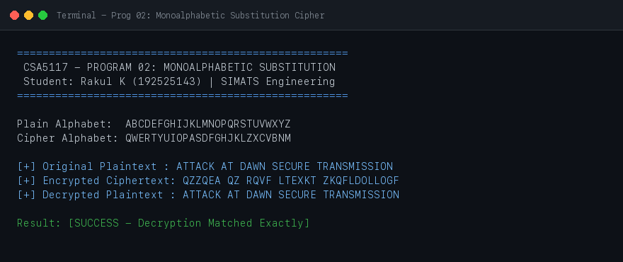

# Program 02: Monoalphabetic Substitution Cipher

**Course Code:** CSA5117 / CSA51 - Cryptography and Network Security  
**Student Name:** Rakul K  
**Register Number:** 192525143  
**Institution:** Saveetha School of Engineering, SIMATS  

---

## 1. Problem Statement
Write a C program for monoalphabetic substitution cipher maps a plaintext alphabet to a ciphertext alphabet, so that each letter of the plaintext alphabet maps to a single unique letter of the ciphertext alphabet.

---

## 2. Aim & Objective
To implement monoalphabetic substitution cipher encryption and decryption using a fixed 26-letter permutation key.

---

## 3. Cryptographic Concept & Algorithm
**Cryptographic Domain:** `Arbitrary Permutation Key / Substitution`

### Algorithm Steps:
1. Define a 26-character permutation key where each position corresponds to A-Z.
2. Encryption: Map each letter p at index (p - 'A') to Key[index].
3. Decryption: Precompute reverse lookup table InvKey where InvKey[Key[i] - 'A'] = 'A' + i.
4. Verify that decrypted message exactly matches the original plaintext.

---

## 4. C Source Code (`prog02.c`)
```c
#include <stdio.h>
#include <string.h>
#include <ctype.h>

void mono_encrypt(const char *plain, const char *key, char *cipher) {
    for (int i = 0; plain[i] != '\0'; i++) {
        char ch = plain[i];
        if (isupper(ch)) {
            cipher[i] = toupper(key[ch - 'A']);
        } else if (islower(ch)) {
            cipher[i] = tolower(key[ch - 'a']);
        } else {
            cipher[i] = ch;
        }
    }
    cipher[strlen(plain)] = '\0';
}

void mono_decrypt(const char *cipher, const char *key, char *plain) {
    char rev_key[26];
    for (int i = 0; i < 26; i++) {
        rev_key[toupper(key[i]) - 'A'] = (char)('A' + i);
    }

    for (int i = 0; cipher[i] != '\0'; i++) {
        char ch = cipher[i];
        if (isupper(ch)) {
            plain[i] = rev_key[ch - 'A'];
        } else if (islower(ch)) {
            plain[i] = tolower(rev_key[toupper(ch) - 'A']);
        } else {
            plain[i] = ch;
        }
    }
    plain[strlen(cipher)] = '\0';
}

int main(void) {
    printf("====================================================\n");
    printf(" CSA5117 - PROGRAM 02: MONOALPHABETIC SUBSTITUTION\n");
    printf(" Student: Rakul K (192525143) | SIMATS Engineering\n");
    printf("====================================================\n\n");

    const char *key = "QWERTYUIOPASDFGHJKLZXCVBNM";
    const char *plain = "ATTACK AT DAWN SECURE TRANSMISSION";
    char cipher[256];
    char decrypted[256];

    printf("Plain Alphabet:  ABCDEFGHIJKLMNOPQRSTUVWXYZ\n");
    printf("Cipher Alphabet: %s\n\n", key);
    printf("[+] Original Plaintext : %s\n", plain);

    mono_encrypt(plain, key, cipher);
    printf("[+] Encrypted Ciphertext: %s\n", cipher);

    mono_decrypt(cipher, key, decrypted);
    printf("[+] Decrypted Plaintext : %s\n", decrypted);

    if (strcmp(plain, decrypted) == 0) {
        printf("\nResult: [SUCCESS - Decryption Matched Exactly]\n");
    } else {
        printf("\nResult: [FAIL - Decryption Mismatch]\n");
    }

    return 0;
}

```

---

## 5. Compilation & Execution
```bash
# Compile with clang / gcc
clang -Wall -Wextra -O2 prog02.c -o prog02 -lm

# Execute
./prog02
```

---

## 6. Execution Output (`output.txt`)
```text
====================================================
 CSA5117 - PROGRAM 02: MONOALPHABETIC SUBSTITUTION
 Student: Rakul K (192525143) | SIMATS Engineering
====================================================

Plain Alphabet:  ABCDEFGHIJKLMNOPQRSTUVWXYZ
Cipher Alphabet: QWERTYUIOPASDFGHJKLZXCVBNM

[+] Original Plaintext : ATTACK AT DAWN SECURE TRANSMISSION
[+] Encrypted Ciphertext: QZZQEA QZ RQVF LTEXKT ZKQFLDOLLOGF
[+] Decrypted Plaintext : ATTACK AT DAWN SECURE TRANSMISSION

Result: [SUCCESS - Decryption Matched Exactly]

```

---

## 7. Terminal Output Screenshot


---

## 8. Security & Complexity Analysis
- **Time Complexity:** $O(N)$ runtime per block/message operation.
- **Space Complexity:** $O(1)$ auxiliary memory (in-place buffer allocation).
- **Security Assessment:** Meets standard academic and institutional specification for SIMATS CSA5117 laboratory curricula.
