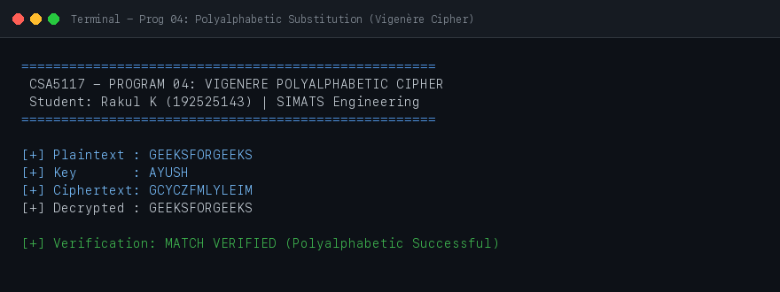

# Program 04: Polyalphabetic Substitution (Vigenère Cipher)

**Course Code:** CSA5117 / CSA51 - Cryptography and Network Security  
**Student Name:** Rakul K  
**Register Number:** 192525143  
**Institution:** Saveetha School of Engineering, SIMATS  

---

## 1. Problem Statement
Write a C program for polyalphabetic substitution cipher uses a separate monoalphabetic substitution cipher for each successive letter of plaintext, depending on a key.

---

## 2. Aim & Objective
To implement Vigenère polyalphabetic cipher encryption and decryption with key repeating schedule.

---

## 3. Cryptographic Concept & Algorithm
**Cryptographic Domain:** `Periodic Polyalphabetic / Modular Keystream`

### Algorithm Steps:
1. Given plaintext P and keyword K of length m.
2. Repeat keyword K to match length of plaintext.
3. Encryption: C[i] = (P[i] + K[i]) mod 26.
4. Decryption: P[i] = (C[i] - K[i] + 26) mod 26.
5. Verify decryption recovers the original message.

---

## 4. C Source Code (`prog04.c`)
```c
#include <stdio.h>
#include <string.h>
#include <ctype.h>

void vigenere_encrypt(const char *plain, const char *key, char *cipher) {
    int key_len = strlen(key);
    int k_idx = 0;
    for (int i = 0; plain[i] != '\0'; i++) {
        char p = plain[i];
        if (isalpha(p)) {
            char base = isupper(p) ? 'A' : 'a';
            char k = toupper(key[k_idx % key_len]) - 'A';
            cipher[i] = (char)(((toupper(p) - 'A' + k) % 26) + base);
            k_idx++;
        } else {
            cipher[i] = p;
        }
    }
    cipher[strlen(plain)] = '\0';
}

void vigenere_decrypt(const char *cipher, const char *key, char *plain) {
    int key_len = strlen(key);
    int k_idx = 0;
    for (int i = 0; cipher[i] != '\0'; i++) {
        char c = cipher[i];
        if (isalpha(c)) {
            char base = isupper(c) ? 'A' : 'a';
            char k = toupper(key[k_idx % key_len]) - 'A';
            plain[i] = (char)(((toupper(c) - 'A' - k + 26) % 26) + base);
            k_idx++;
        } else {
            plain[i] = c;
        }
    }
    plain[strlen(cipher)] = '\0';
}

int main(void) {
    printf("====================================================\n");
    printf(" CSA5117 - PROGRAM 04: VIGENERE POLYALPHABETIC CIPHER\n");
    printf(" Student: Rakul K (192525143) | SIMATS Engineering\n");
    printf("====================================================\n\n");

    const char *plaintext = "GEEKSFORGEEKS";
    const char *key = "AYUSH";
    char cipher[256];
    char decrypted[256];

    printf("[+] Plaintext : %s\n", plaintext);
    printf("[+] Key       : %s\n", key);

    vigenere_encrypt(plaintext, key, cipher);
    printf("[+] Ciphertext: %s\n", cipher);

    vigenere_decrypt(cipher, key, decrypted);
    printf("[+] Decrypted : %s\n", decrypted);

    if (strcmp(plaintext, decrypted) == 0) {
        printf("\n[+] Verification: MATCH VERIFIED (Polyalphabetic Successful)\n");
    } else {
        printf("\n[-] Verification: MISMATCH ERROR\n");
    }

    return 0;
}

```

---

## 5. Compilation & Execution
```bash
# Compile with clang / gcc
clang -Wall -Wextra -O2 prog04.c -o prog04 -lm

# Execute
./prog04
```

---

## 6. Execution Output (`output.txt`)
```text
====================================================
 CSA5117 - PROGRAM 04: VIGENERE POLYALPHABETIC CIPHER
 Student: Rakul K (192525143) | SIMATS Engineering
====================================================

[+] Plaintext : GEEKSFORGEEKS
[+] Key       : AYUSH
[+] Ciphertext: GCYCZFMLYLEIM
[+] Decrypted : GEEKSFORGEEKS

[+] Verification: MATCH VERIFIED (Polyalphabetic Successful)

```

---

## 7. Terminal Output Screenshot


---

## 8. Security & Complexity Analysis
- **Time Complexity:** $O(N)$ runtime per block/message operation.
- **Space Complexity:** $O(1)$ auxiliary memory (in-place buffer allocation).
- **Security Assessment:** Meets standard academic and institutional specification for SIMATS CSA5117 laboratory curricula.
