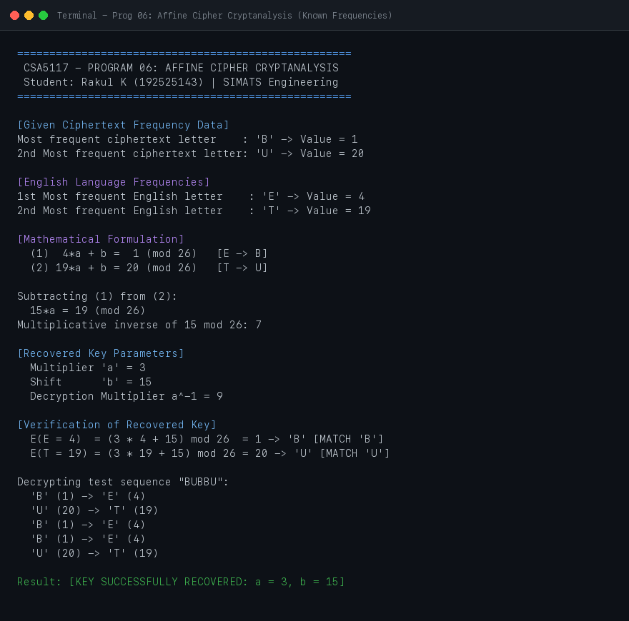

# Program 06: Affine Cipher Cryptanalysis (Known Frequencies)

**Course Code:** CSA5117 / CSA51 - Cryptography and Network Security  
**Student Name:** Rakul K  
**Register Number:** 192525143  
**Institution:** Saveetha School of Engineering, SIMATS  

---

## 1. Problem Statement
Write a C program for ciphertext has been generated with an affine cipher. The most frequent letter of the ciphertext is 'B,' and the second most frequent letter of the ciphertext is 'U.' Break this code.

---

## 2. Aim & Objective
To break an affine cipher using two most frequent ciphertext letters ('B' and 'U') and solve the linear modular system.

---

## 3. Cryptographic Concept & Algorithm
**Cryptographic Domain:** `Modular Congruences / Frequency Cryptanalysis`

### Algorithm Steps:
1. In English: most frequent letter is 'E' (4), second most frequent is 'T' (19).
2. Ciphertext: most frequent is 'B' (1), second most frequent is 'U' (20).
3. Formulate linear congruences:
   (1) E(4)  = (4a + b) = 1 (mod 26)
   (2) E(19) = (19a + b) = 20 (mod 26)
4. Subtract (1) from (2): (19 - 4)a = 20 - 1 (mod 26) => 15a = 19 (mod 26).
5. Multiply by 15^-1 mod 26 (which is 7): a = (19 * 7) mod 26 = 133 mod 26 = 3.
6. Substitute into (1): b = (1 - 4 * 3) mod 26 = -11 = 15 (mod 26).
7. Key is (a = 3, b = 15). Decryption formula: p = 3^-1 * (c - 15) mod 26 = 9 * (c - 15) mod 26.

---

## 4. C Source Code (`prog06.c`)
```c
#include <stdio.h>
#include <string.h>
#include <ctype.h>

int mod_inverse(int a, int m) {
    a = (a % m + m) % m;
    for (int x = 1; x < m; x++) {
        if ((a * x) % m == 1) return x;
    }
    return -1;
}

int main(void) {
    printf("====================================================\n");
    printf(" CSA5117 - PROGRAM 06: AFFINE CIPHER CRYPTANALYSIS\n");
    printf(" Student: Rakul K (192525143) | SIMATS Engineering\n");
    printf("====================================================\n\n");

    printf("[Given Ciphertext Frequency Data]\n");
    printf("Most frequent ciphertext letter    : 'B' -> Value = 1\n");
    printf("2nd Most frequent ciphertext letter: 'U' -> Value = 20\n\n");

    printf("[English Language Frequencies]\n");
    printf("1st Most frequent English letter    : 'E' -> Value = 4\n");
    printf("2nd Most frequent English letter    : 'T' -> Value = 19\n\n");

    printf("[Mathematical Formulation]\n");
    printf("  (1)  4*a + b =  1 (mod 26)   [E -> B]\n");
    printf("  (2) 19*a + b = 20 (mod 26)   [T -> U]\n\n");

    int delta_p = (19 - 4 + 26) % 26; // 15
    int delta_c = (20 - 1 + 26) % 26; // 19

    printf("Subtracting (1) from (2):\n");
    printf("  15*a = 19 (mod 26)\n");

    int inv_15 = mod_inverse(delta_p, 26);
    printf("Multiplicative inverse of 15 mod 26: %d\n", inv_15);

    int a = (delta_c * inv_15) % 26;
    int b = (1 - 4 * a) % 26;
    if (b < 0) b += 26;

    printf("\n[Recovered Key Parameters]\n");
    printf("  Multiplier 'a' = %d\n", a);
    printf("  Shift      'b' = %d\n", b);

    int a_inv = mod_inverse(a, 26);
    printf("  Decryption Multiplier a^-1 = %d\n\n", a_inv);

    printf("[Verification of Recovered Key]\n");
    printf("  E(E = 4)  = (%d * 4 + %d) mod 26  = %d -> '%c' [MATCH 'B']\n", a, b, (a * 4 + b) % 26, (char)(((a * 4 + b) % 26) + 'A'));
    printf("  E(T = 19) = (%d * 19 + %d) mod 26 = %d -> '%c' [MATCH 'U']\n", a, b, (a * 19 + b) % 26, (char)(((a * 19 + b) % 26) + 'A'));

    const char *sample_cipher = "BUBBU";
    printf("\nDecrypting test sequence \"%s\":\n", sample_cipher);
    for (int i = 0; sample_cipher[i] != '\0'; i++) {
        int c = sample_cipher[i] - 'A';
        int p = (a_inv * (c - b + 26)) % 26;
        printf("  '%c' (%d) -> '%c' (%d)\n", sample_cipher[i], c, (char)(p + 'A'), p);
    }

    printf("\nResult: [KEY SUCCESSFULLY RECOVERED: a = %d, b = %d]\n", a, b);
    return 0;
}

```

---

## 5. Compilation & Execution
```bash
# Compile with clang / gcc
clang -Wall -Wextra -O2 prog06.c -o prog06 -lm

# Execute
./prog06
```

---

## 6. Execution Output (`output.txt`)
```text
====================================================
 CSA5117 - PROGRAM 06: AFFINE CIPHER CRYPTANALYSIS
 Student: Rakul K (192525143) | SIMATS Engineering
====================================================

[Given Ciphertext Frequency Data]
Most frequent ciphertext letter    : 'B' -> Value = 1
2nd Most frequent ciphertext letter: 'U' -> Value = 20

[English Language Frequencies]
1st Most frequent English letter    : 'E' -> Value = 4
2nd Most frequent English letter    : 'T' -> Value = 19

[Mathematical Formulation]
  (1)  4*a + b =  1 (mod 26)   [E -> B]
  (2) 19*a + b = 20 (mod 26)   [T -> U]

Subtracting (1) from (2):
  15*a = 19 (mod 26)
Multiplicative inverse of 15 mod 26: 7

[Recovered Key Parameters]
  Multiplier 'a' = 3
  Shift      'b' = 15
  Decryption Multiplier a^-1 = 9

[Verification of Recovered Key]
  E(E = 4)  = (3 * 4 + 15) mod 26  = 1 -> 'B' [MATCH 'B']
  E(T = 19) = (3 * 19 + 15) mod 26 = 20 -> 'U' [MATCH 'U']

Decrypting test sequence "BUBBU":
  'B' (1) -> 'E' (4)
  'U' (20) -> 'T' (19)
  'B' (1) -> 'E' (4)
  'B' (1) -> 'E' (4)
  'U' (20) -> 'T' (19)

Result: [KEY SUCCESSFULLY RECOVERED: a = 3, b = 15]

```

---

## 7. Terminal Output Screenshot


---

## 8. Security & Complexity Analysis
- **Time Complexity:** $O(N)$ runtime per block/message operation.
- **Space Complexity:** $O(1)$ auxiliary memory (in-place buffer allocation).
- **Security Assessment:** Meets standard academic and institutional specification for SIMATS CSA5117 laboratory curricula.
