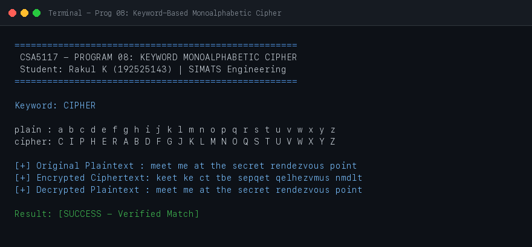

# Program 08: Keyword-Based Monoalphabetic Cipher

**Course Code:** CSA5117 / CSA51 - Cryptography and Network Security  
**Student Name:** Rakul K  
**Register Number:** 192525143  
**Institution:** Saveetha School of Engineering, SIMATS  

---

## 1. Problem Statement
Write a C program for monoalphabetic cipher using a keyword (e.g. CIPHER) from which the cipher sequence can be generated and matched against plaintext letters.

---

## 2. Aim & Objective
To generate a monoalphabetic substitution alphabet from a given keyword and perform encryption and decryption.

---

## 3. Cryptographic Concept & Algorithm
**Cryptographic Domain:** `Keyword Key Generation / Permutation Cipher`

### Algorithm Steps:
1. Take keyword, eliminate duplicate letters, and place in cipher alphabet starting from index 0.
2. Fill remaining positions with unused alphabet letters in alphabetical order.
3. Align with standard plain alphabet: plain[i] -> cipher[i].
4. Encrypt plaintext by substituting each character.
5. Decrypt by inverse table lookup.

---

## 4. C Source Code (`prog08.c`)
```c
#include <stdio.h>
#include <string.h>
#include <ctype.h>

void generate_cipher_alphabet(const char *keyword, char *cipher_alpha) {
    int used[26] = {0};
    int idx = 0;

    for (int i = 0; keyword[i] != '\0'; i++) {
        char ch = toupper(keyword[i]);
        if (isalpha(ch) && !used[ch - 'A']) {
            used[ch - 'A'] = 1;
            cipher_alpha[idx++] = ch;
        }
    }
    for (char ch = 'A'; ch <= 'Z'; ch++) {
        if (!used[ch - 'A']) {
            used[ch - 'A'] = 1;
            cipher_alpha[idx++] = ch;
        }
    }
    cipher_alpha[26] = '\0';
}

void encrypt(const char *plain, const char *cipher_alpha, char *cipher) {
    for (int i = 0; plain[i] != '\0'; i++) {
        char ch = plain[i];
        if (isalpha(ch)) {
            char base = isupper(ch) ? 'A' : 'a';
            cipher[i] = (char)(cipher_alpha[toupper(ch) - 'A'] - 'A' + base);
        } else {
            cipher[i] = ch;
        }
    }
    cipher[strlen(plain)] = '\0';
}

void decrypt(const char *cipher, const char *cipher_alpha, char *plain) {
    char inv[26];
    for (int i = 0; i < 26; i++) {
        inv[cipher_alpha[i] - 'A'] = (char)('A' + i);
    }
    for (int i = 0; cipher[i] != '\0'; i++) {
        char ch = cipher[i];
        if (isalpha(ch)) {
            char base = isupper(ch) ? 'A' : 'a';
            plain[i] = (char)(inv[toupper(ch) - 'A'] - 'A' + base);
        } else {
            plain[i] = ch;
        }
    }
    plain[strlen(cipher)] = '\0';
}

int main(void) {
    printf("====================================================\n");
    printf(" CSA5117 - PROGRAM 08: KEYWORD MONOALPHABETIC CIPHER\n");
    printf(" Student: Rakul K (192525143) | SIMATS Engineering\n");
    printf("====================================================\n\n");

    const char *keyword = "CIPHER";
    char cipher_alpha[27];
    generate_cipher_alphabet(keyword, cipher_alpha);

    printf("Keyword: %s\n\n", keyword);
    printf("plain : a b c d e f g h i j k l m n o p q r s t u v w x y z\n");
    printf("cipher: ");
    for (int i = 0; i < 26; i++) {
        printf("%c ", cipher_alpha[i]);
    }
    printf("\n\n");

    const char *plaintext = "meet me at the secret rendezvous point";
    char ciphertext[256];
    char decrypted[256];

    encrypt(plaintext, cipher_alpha, ciphertext);
    decrypt(ciphertext, cipher_alpha, decrypted);

    printf("[+] Original Plaintext : %s\n", plaintext);
    printf("[+] Encrypted Ciphertext: %s\n", ciphertext);
    printf("[+] Decrypted Plaintext : %s\n", decrypted);

    if (strcmp(plaintext, decrypted) == 0) {
        printf("\nResult: [SUCCESS - Verified Match]\n");
    } else {
        printf("\nResult: [FAIL - Verification Failed]\n");
    }

    return 0;
}

```

---

## 5. Compilation & Execution
```bash
# Compile with clang / gcc
clang -Wall -Wextra -O2 prog08.c -o prog08 -lm

# Execute
./prog08
```

---

## 6. Execution Output (`output.txt`)
```text
====================================================
 CSA5117 - PROGRAM 08: KEYWORD MONOALPHABETIC CIPHER
 Student: Rakul K (192525143) | SIMATS Engineering
====================================================

Keyword: CIPHER

plain : a b c d e f g h i j k l m n o p q r s t u v w x y z
cipher: C I P H E R A B D F G J K L M N O Q S T U V W X Y Z 

[+] Original Plaintext : meet me at the secret rendezvous point
[+] Encrypted Ciphertext: keet ke ct tbe sepqet qelhezvmus nmdlt
[+] Decrypted Plaintext : meet me at the secret rendezvous point

Result: [SUCCESS - Verified Match]

```

---

## 7. Terminal Output Screenshot


---

## 8. Security & Complexity Analysis
- **Time Complexity:** $O(N)$ runtime per block/message operation.
- **Space Complexity:** $O(1)$ auxiliary memory (in-place buffer allocation).
- **Security Assessment:** Meets standard academic and institutional specification for SIMATS CSA5117 laboratory curricula.
