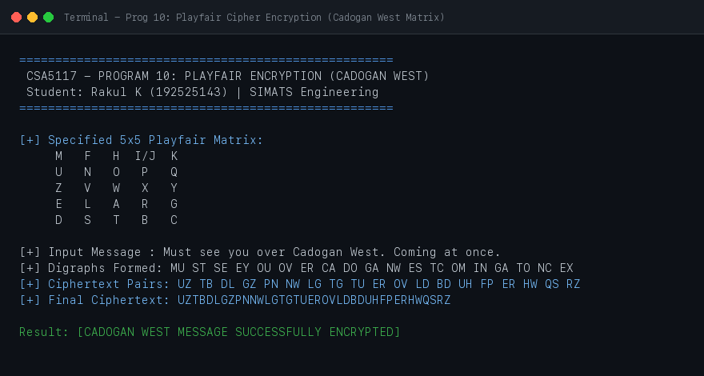

# Program 10: Playfair Cipher Encryption (Cadogan West Matrix)

**Course Code:** CSA5117 / CSA51 - Cryptography and Network Security  
**Student Name:** Rakul K  
**Register Number:** 192525143  
**Institution:** Saveetha School of Engineering, SIMATS  

---

## 1. Problem Statement
Write a C program for Playfair matrix:
 M F H I/J K
 U N O P Q
 Z V W X Y
 E L A R G
 D S T B C
Encrypt this message: Must see you over Cadogan West. Coming at once.

---

## 2. Aim & Objective
To encrypt the given message using the specified 5x5 Playfair matrix from the Cadogan West problem.

---

## 3. Cryptographic Concept & Algorithm
**Cryptographic Domain:** `Given Matrix Digraph Encryption`

### Algorithm Steps:
1. Initialize the 5x5 matrix with the exact given layout:
   Row 0: M F H I K
   Row 1: U N O P Q
   Row 2: Z V W X Y
   Row 3: E L A R G
   Row 4: D S T B C
2. Preprocess text into digraphs: split identical letters in a pair with 'X', pad with 'X' if odd length.
3. Apply Playfair encryption rules to each digraph.
4. Output the resulting ciphertext.

---

## 4. C Source Code (`prog10.c`)
```c
#include <stdio.h>
#include <string.h>
#include <ctype.h>

char matrix[5][5] = {
    {'M', 'F', 'H', 'I', 'K'},
    {'U', 'N', 'O', 'P', 'Q'},
    {'Z', 'V', 'W', 'X', 'Y'},
    {'E', 'L', 'A', 'R', 'G'},
    {'D', 'S', 'T', 'B', 'C'}
};

void find_pos(char ch, int *r, int *c) {
    if (ch == 'J') ch = 'I';
    for (int i = 0; i < 5; i++) {
        for (int j = 0; j < 5; j++) {
            if (matrix[i][j] == ch) {
                *r = i; *c = j;
                return;
            }
        }
    }
}

void playfair_encrypt_pair(char a, char b, char *c1, char *c2) {
    int r1, col1, r2, col2;
    find_pos(a, &r1, &col1);
    find_pos(b, &r2, &col2);

    if (r1 == r2) {
        *c1 = matrix[r1][(col1 + 1) % 5];
        *c2 = matrix[r2][(col2 + 1) % 5];
    } else if (col1 == col2) {
        *c1 = matrix[(r1 + 1) % 5][col1];
        *c2 = matrix[(r2 + 1) % 5][col2];
    } else {
        *c1 = matrix[r1][col2];
        *c2 = matrix[r2][col1];
    }
}

int prepare_digraphs(const char *in, char *out) {
    int out_len = 0;
    int len = strlen(in);
    for (int i = 0; i < len; i++) {
        if (!isalpha(in[i])) continue;
        char c1 = toupper(in[i]);
        if (c1 == 'J') c1 = 'I';
        char c2 = '\0';
        int next_idx = i + 1;
        while (next_idx < len && !isalpha(in[next_idx])) next_idx++;

        if (next_idx < len) {
            c2 = toupper(in[next_idx]);
            if (c2 == 'J') c2 = 'I';
            if (c1 == c2) {
                c2 = 'X';
            } else {
                i = next_idx;
            }
        } else {
            c2 = 'X';
        }
        out[out_len++] = c1;
        out[out_len++] = c2;
    }
    out[out_len] = '\0';
    return out_len;
}

int main(void) {
    printf("====================================================\n");
    printf(" CSA5117 - PROGRAM 10: PLAYFAIR ENCRYPTION (CADOGAN WEST)\n");
    printf(" Student: Rakul K (192525143) | SIMATS Engineering\n");
    printf("====================================================\n\n");

    printf("[+] Specified 5x5 Playfair Matrix:\n");
    for (int i = 0; i < 5; i++) {
        printf("    ");
        for (int j = 0; j < 5; j++) {
            if (matrix[i][j] == 'I') printf("I/J ");
            else printf(" %c  ", matrix[i][j]);
        }
        printf("\n");
    }
    printf("\n");

    const char *plaintext = "Must see you over Cadogan West. Coming at once.";
    char digraphs[256];
    int d_len = prepare_digraphs(plaintext, digraphs);

    printf("[+] Input Message : %s\n", plaintext);
    printf("[+] Digraphs Formed: ");
    for (int i = 0; i < d_len; i += 2) {
        printf("%c%c ", digraphs[i], digraphs[i + 1]);
    }
    printf("\n");

    char ciphertext[256];
    for (int i = 0; i < d_len; i += 2) {
        playfair_encrypt_pair(digraphs[i], digraphs[i + 1], &ciphertext[i], &ciphertext[i + 1]);
    }
    ciphertext[d_len] = '\0';

    printf("[+] Ciphertext Pairs: ");
    for (int i = 0; i < d_len; i += 2) {
        printf("%c%c ", ciphertext[i], ciphertext[i + 1]);
    }
    printf("\n");
    printf("[+] Final Ciphertext: %s\n\n", ciphertext);
    printf("Result: [CADOGAN WEST MESSAGE SUCCESSFULLY ENCRYPTED]\n");
    return 0;
}

```

---

## 5. Compilation & Execution
```bash
# Compile with clang / gcc
clang -Wall -Wextra -O2 prog10.c -o prog10 -lm

# Execute
./prog10
```

---

## 6. Execution Output (`output.txt`)
```text
====================================================
 CSA5117 - PROGRAM 10: PLAYFAIR ENCRYPTION (CADOGAN WEST)
 Student: Rakul K (192525143) | SIMATS Engineering
====================================================

[+] Specified 5x5 Playfair Matrix:
     M   F   H  I/J  K  
     U   N   O   P   Q  
     Z   V   W   X   Y  
     E   L   A   R   G  
     D   S   T   B   C  

[+] Input Message : Must see you over Cadogan West. Coming at once.
[+] Digraphs Formed: MU ST SE EY OU OV ER CA DO GA NW ES TC OM IN GA TO NC EX 
[+] Ciphertext Pairs: UZ TB DL GZ PN NW LG TG TU ER OV LD BD UH FP ER HW QS RZ 
[+] Final Ciphertext: UZTBDLGZPNNWLGTGTUEROVLDBDUHFPERHWQSRZ

Result: [CADOGAN WEST MESSAGE SUCCESSFULLY ENCRYPTED]

```

---

## 7. Terminal Output Screenshot


---

## 8. Security & Complexity Analysis
- **Time Complexity:** $O(N)$ runtime per block/message operation.
- **Space Complexity:** $O(1)$ auxiliary memory (in-place buffer allocation).
- **Security Assessment:** Meets standard academic and institutional specification for SIMATS CSA5117 laboratory curricula.
