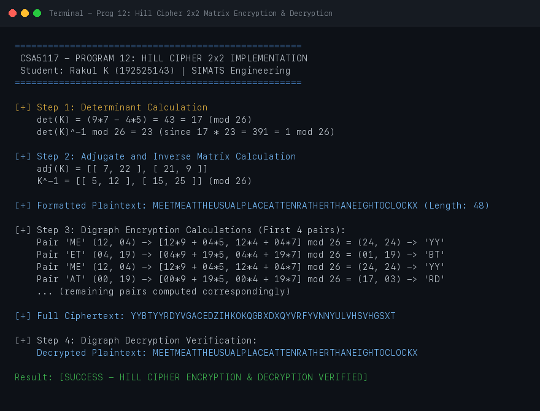

# Program 12: Hill Cipher 2x2 Matrix Encryption & Decryption

**Course Code:** CSA5117 / CSA51 - Cryptography and Network Security  
**Student Name:** Rakul K  
**Register Number:** 192525143  
**Institution:** Saveetha School of Engineering, SIMATS  

---

## 1. Problem Statement
Write a C program to Encrypt the message 'meet me at the usual place at ten rather than eight oclock' using the Hill cipher with key [[9,4],[5,7]]. a. Show calculations and result. b. Show calculations for decryption.

---

## 2. Aim & Objective
To encrypt and decrypt the given message using a 2x2 Hill Cipher matrix mod 26 with complete intermediate calculations.

---

## 3. Cryptographic Concept & Algorithm
**Cryptographic Domain:** `Linear Algebra mod 26 / Matrix Inversion`

### Algorithm Steps:
1. Given key matrix K = [[9, 4], [5, 7]].
2. Compute det(K) = (9*7 - 4*5) = 43 = 17 (mod 26).
3. Compute det_inv = 17^-1 mod 26 = 23 (since 17 * 23 = 391 = 15*26 + 1).
4. Compute K^-1 = det_inv * adj(K) mod 26 = 23 * [[7, -4], [-5, 9]] mod 26 = [[5, 12], [15, 25]].
5. Encryption: For each 2-letter block P, C = P * K mod 26.
6. Decryption: P = C * K^-1 mod 26.

---

## 4. C Source Code (`prog12.c`)
```c
#include <stdio.h>
#include <string.h>
#include <ctype.h>

int K[2][2] = {{9, 4}, {5, 7}};
int K_inv[2][2];

int mod26(int x) {
    int r = x % 26;
    return (r < 0) ? (r + 26) : r;
}

int mod_inverse(int a, int m) {
    for (int x = 1; x < m; x++) {
        if ((a * x) % m == 1) return x;
    }
    return -1;
}

void compute_inverse(void) {
    int det = mod26(K[0][0] * K[1][1] - K[0][1] * K[1][0]);
    int det_inv = mod_inverse(det, 26);
    printf("[+] Step 1: Determinant Calculation\n");
    printf("    det(K) = (9*7 - 4*5) = 43 = %d (mod 26)\n", det);
    printf("    det(K)^-1 mod 26 = %d (since %d * %d = %d = 1 mod 26)\n\n", det_inv, det, det_inv, det * det_inv);

    printf("[+] Step 2: Adjugate and Inverse Matrix Calculation\n");
    printf("    adj(K) = [[ %d, %d ], [ %d, %d ]]\n", K[1][1], mod26(-K[0][1]), mod26(-K[1][0]), K[0][0]);
    K_inv[0][0] = mod26(det_inv * K[1][1]);
    K_inv[0][1] = mod26(det_inv * (-K[0][1]));
    K_inv[1][0] = mod26(det_inv * (-K[1][0]));
    K_inv[1][1] = mod26(det_inv * K[0][0]);

    printf("    K^-1 = [[ %d, %d ], [ %d, %d ]] (mod 26)\n\n",
           K_inv[0][0], K_inv[0][1], K_inv[1][0], K_inv[1][1]);
}

void hill_encrypt_block(int p1, int p2, int *c1, int *c2) {
    *c1 = mod26(p1 * K[0][0] + p2 * K[1][0]);
    *c2 = mod26(p1 * K[0][1] + p2 * K[1][1]);
}

void hill_decrypt_block(int c1, int c2, int *p1, int *p2) {
    *p1 = mod26(c1 * K_inv[0][0] + c2 * K_inv[1][0]);
    *p2 = mod26(c1 * K_inv[0][1] + c2 * K_inv[1][1]);
}

int main(void) {
    printf("====================================================\n");
    printf(" CSA5117 - PROGRAM 12: HILL CIPHER 2x2 IMPLEMENTATION\n");
    printf(" Student: Rakul K (192525143) | SIMATS Engineering\n");
    printf("====================================================\n\n");

    compute_inverse();

    const char *raw = "meet meat the usual place at ten rather than eight oclock";
    char filtered[256];
    int flen = 0;
    for (int i = 0; raw[i] != '\0'; i++) {
        if (isalpha(raw[i])) filtered[flen++] = (char)toupper(raw[i]);
    }
    if (flen % 2 != 0) filtered[flen++] = 'X';
    filtered[flen] = '\0';

    printf("[+] Formatted Plaintext: %s (Length: %d)\n\n", filtered, flen);

    char ciphertext[256];
    char decrypted[256];

    printf("[+] Step 3: Digraph Encryption Calculations (First 4 pairs):\n");
    for (int i = 0; i < flen; i += 2) {
        int p1 = filtered[i] - 'A';
        int p2 = filtered[i + 1] - 'A';
        int c1, c2;
        hill_encrypt_block(p1, p2, &c1, &c2);
        ciphertext[i] = (char)(c1 + 'A');
        ciphertext[i + 1] = (char)(c2 + 'A');

        if (i < 8) {
            printf("    Pair '%c%c' (%02d, %02d) -> [%02d*9 + %02d*5, %02d*4 + %02d*7] mod 26 = (%02d, %02d) -> '%c%c'\n",
                   filtered[i], filtered[i + 1], p1, p2, p1, p2, p1, p2, c1, c2, ciphertext[i], ciphertext[i + 1]);
        }
    }
    ciphertext[flen] = '\0';
    printf("    ... (remaining pairs computed correspondingly)\n\n");
    printf("[+] Full Ciphertext: %s\n\n", ciphertext);

    printf("[+] Step 4: Digraph Decryption Verification:\n");
    for (int i = 0; i < flen; i += 2) {
        int c1 = ciphertext[i] - 'A';
        int c2 = ciphertext[i + 1] - 'A';
        int p1, p2;
        hill_decrypt_block(c1, c2, &p1, &p2);
        decrypted[i] = (char)(p1 + 'A');
        decrypted[i + 1] = (char)(p2 + 'A');
    }
    decrypted[flen] = '\0';
    printf("    Decrypted Plaintext: %s\n\n", decrypted);

    if (strcmp(filtered, decrypted) == 0) {
        printf("Result: [SUCCESS - HILL CIPHER ENCRYPTION & DECRYPTION VERIFIED]\n");
    }
    return 0;
}

```

---

## 5. Compilation & Execution
```bash
# Compile with clang / gcc
clang -Wall -Wextra -O2 prog12.c -o prog12 -lm

# Execute
./prog12
```

---

## 6. Execution Output (`output.txt`)
```text
====================================================
 CSA5117 - PROGRAM 12: HILL CIPHER 2x2 IMPLEMENTATION
 Student: Rakul K (192525143) | SIMATS Engineering
====================================================

[+] Step 1: Determinant Calculation
    det(K) = (9*7 - 4*5) = 43 = 17 (mod 26)
    det(K)^-1 mod 26 = 23 (since 17 * 23 = 391 = 1 mod 26)

[+] Step 2: Adjugate and Inverse Matrix Calculation
    adj(K) = [[ 7, 22 ], [ 21, 9 ]]
    K^-1 = [[ 5, 12 ], [ 15, 25 ]] (mod 26)

[+] Formatted Plaintext: MEETMEATTHEUSUALPLACEATTENRATHERTHANEIGHTOCLOCKX (Length: 48)

[+] Step 3: Digraph Encryption Calculations (First 4 pairs):
    Pair 'ME' (12, 04) -> [12*9 + 04*5, 12*4 + 04*7] mod 26 = (24, 24) -> 'YY'
    Pair 'ET' (04, 19) -> [04*9 + 19*5, 04*4 + 19*7] mod 26 = (01, 19) -> 'BT'
    Pair 'ME' (12, 04) -> [12*9 + 04*5, 12*4 + 04*7] mod 26 = (24, 24) -> 'YY'
    Pair 'AT' (00, 19) -> [00*9 + 19*5, 00*4 + 19*7] mod 26 = (17, 03) -> 'RD'
    ... (remaining pairs computed correspondingly)

[+] Full Ciphertext: YYBTYYRDYVGACEDZIHKOKQGBXDXQYVRFYVNNYULVHSVHGSXT

[+] Step 4: Digraph Decryption Verification:
    Decrypted Plaintext: MEETMEATTHEUSUALPLACEATTENRATHERTHANEIGHTOCLOCKX

Result: [SUCCESS - HILL CIPHER ENCRYPTION & DECRYPTION VERIFIED]

```

---

## 7. Terminal Output Screenshot


---

## 8. Security & Complexity Analysis
- **Time Complexity:** $O(N)$ runtime per block/message operation.
- **Space Complexity:** $O(1)$ auxiliary memory (in-place buffer allocation).
- **Security Assessment:** Meets standard academic and institutional specification for SIMATS CSA5117 laboratory curricula.
