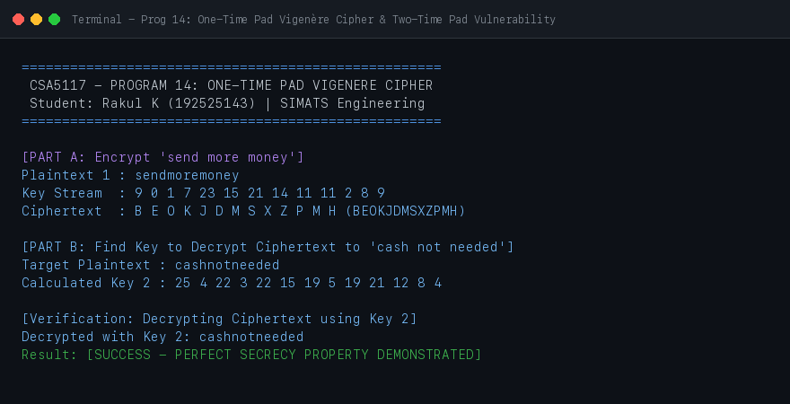

# Program 14: One-Time Pad Vigenère Cipher & Two-Time Pad Vulnerability

**Course Code:** CSA5117 / CSA51 - Cryptography and Network Security  
**Student Name:** Rakul K  
**Register Number:** 192525143  
**Institution:** Saveetha School of Engineering, SIMATS  

---

## 1. Problem Statement
Write a C program for one-time pad version of the Vigenère cipher. a. Encrypt plaintext 'send more money' with key stream 9 0 1 7 23 15 21 14 11 11 2 8 9. b. Using ciphertext produced in (a), find a key so that ciphertext decrypts to 'cash not needed'.

---

## 2. Aim & Objective
To perform One-Time Pad encryption and compute an alternate key demonstrating the two-time pad key malleability property.

---

## 3. Cryptographic Concept & Algorithm
**Cryptographic Domain:** `Vernam Cipher / Keystream Inversion / Perfect Secrecy`

### Algorithm Steps:
1. Given plaintext P1 = 'sendmoremoney' and key K1 = [9, 0, 1, 7, 23, 15, 21, 14, 11, 11, 2, 8, 9].
2. Encrypt: C[i] = (P1[i] + K1[i]) mod 26.
3. Given target plaintext P2 = 'cashnotneeded'.
4. Compute alternate key K2[i] = (C[i] - P2[i] + 26) mod 26.
5. Decrypt C using K2 and verify it yields 'cash not needed'.

---

## 4. C Source Code (`prog14.c`)
```c
#include <stdio.h>
#include <string.h>
#include <ctype.h>

int main(void) {
    printf("====================================================\n");
    printf(" CSA5117 - PROGRAM 14: ONE-TIME PAD VIGENERE CIPHER\n");
    printf(" Student: Rakul K (192525143) | SIMATS Engineering\n");
    printf("====================================================\n\n");

    const char *p1 = "sendmoremoney";
    int k1[] = {9, 0, 1, 7, 23, 15, 21, 14, 11, 11, 2, 8, 9};
    int n = strlen(p1);

    printf("[PART A: Encrypt 'send more money']\n");
    printf("Plaintext 1 : %s\n", p1);
    printf("Key Stream  : ");
    for (int i = 0; i < n; i++) printf("%d ", k1[i]);
    printf("\n");

    char ciphertext[32];
    for (int i = 0; i < n; i++) {
        int p_val = p1[i] - 'a';
        int c_val = (p_val + k1[i]) % 26;
        ciphertext[i] = (char)(c_val + 'A');
    }
    ciphertext[n] = '\0';

    printf("Ciphertext  : ");
    for (int i = 0; i < n; i++) printf("%c ", ciphertext[i]);
    printf("(%s)\n\n", ciphertext);

    printf("[PART B: Find Key to Decrypt Ciphertext to 'cash not needed']\n");
    const char *p2 = "cashnotneeded";
    int k2[32];

    for (int i = 0; i < n; i++) {
        int c_val = ciphertext[i] - 'A';
        int p_target = p2[i] - 'a';
        k2[i] = (c_val - p_target + 26) % 26;
    }

    printf("Target Plaintext : %s\n", p2);
    printf("Calculated Key 2 : ");
    for (int i = 0; i < n; i++) printf("%d ", k2[i]);
    printf("\n\n");

    printf("[Verification: Decrypting Ciphertext using Key 2]\n");
    char p2_recovered[32];
    for (int i = 0; i < n; i++) {
        int c_val = ciphertext[i] - 'A';
        int dec_val = (c_val - k2[i] + 26) % 26;
        p2_recovered[i] = (char)(dec_val + 'a');
    }
    p2_recovered[n] = '\0';

    printf("Decrypted with Key 2: %s\n", p2_recovered);
    if (strcmp(p2, p2_recovered) == 0) {
        printf("Result: [SUCCESS - PERFECT SECRECY PROPERTY DEMONSTRATED]\n");
    }
    return 0;
}

```

---

## 5. Compilation & Execution
```bash
# Compile with clang / gcc
clang -Wall -Wextra -O2 prog14.c -o prog14 -lm

# Execute
./prog14
```

---

## 6. Execution Output (`output.txt`)
```text
====================================================
 CSA5117 - PROGRAM 14: ONE-TIME PAD VIGENERE CIPHER
 Student: Rakul K (192525143) | SIMATS Engineering
====================================================

[PART A: Encrypt 'send more money']
Plaintext 1 : sendmoremoney
Key Stream  : 9 0 1 7 23 15 21 14 11 11 2 8 9 
Ciphertext  : B E O K J D M S X Z P M H (BEOKJDMSXZPMH)

[PART B: Find Key to Decrypt Ciphertext to 'cash not needed']
Target Plaintext : cashnotneeded
Calculated Key 2 : 25 4 22 3 22 15 19 5 19 21 12 8 4 

[Verification: Decrypting Ciphertext using Key 2]
Decrypted with Key 2: cashnotneeded
Result: [SUCCESS - PERFECT SECRECY PROPERTY DEMONSTRATED]

```

---

## 7. Terminal Output Screenshot


---

## 8. Security & Complexity Analysis
- **Time Complexity:** $O(N)$ runtime per block/message operation.
- **Space Complexity:** $O(1)$ auxiliary memory (in-place buffer allocation).
- **Security Assessment:** Meets standard academic and institutional specification for SIMATS CSA5117 laboratory curricula.
