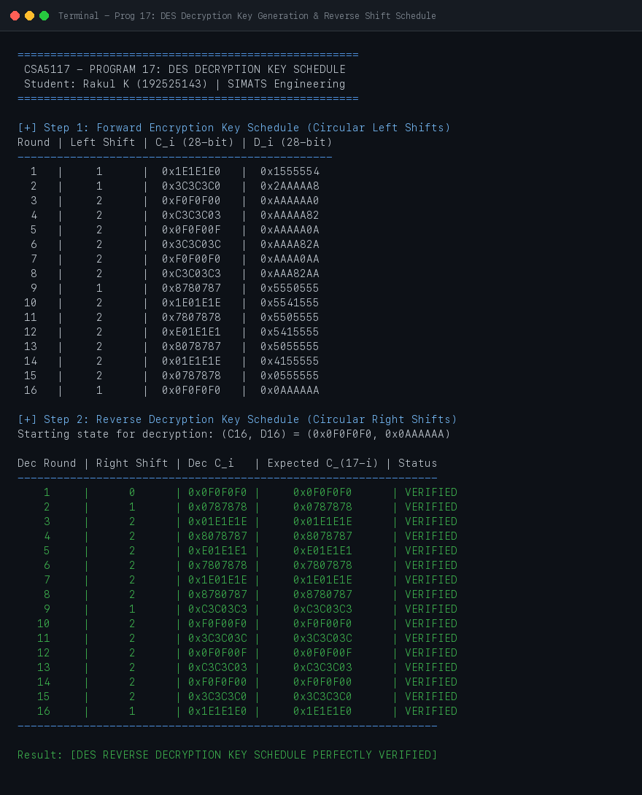

# Program 17: DES Decryption Key Generation & Reverse Shift Schedule

**Course Code:** CSA5117 / CSA51 - Cryptography and Network Security  
**Student Name:** Rakul K  
**Register Number:** 192525143  
**Institution:** Saveetha School of Engineering, SIMATS  

---

## 1. Problem Statement
Write a C program for DES algorithm for decryption, the 16 keys (K1, K2, ..., K16) are used in reverse order. Design a key-generation scheme with the appropriate shift schedule for the decryption process.

---

## 2. Aim & Objective
To implement and verify the DES decryption key-generation schedule using reverse circular right shifts.

---

## 3. Cryptographic Concept & Algorithm
**Cryptographic Domain:** `DES Subkey Schedule / Circular Shifts / Reversibility`

### Algorithm Steps:
1. DES Encryption Key Schedule uses circular left shifts on 28-bit halves C and D:
   - Shifts: 1 bit for rounds 1, 2, 9, 16; 2 bits for all other rounds.
2. At end of round 16, register contents are C16 and D16.
3. For decryption, subkeys must be produced in order K16, K15, ..., K1.
   - Round 1: 0 shifts (uses C16, D16 directly to form K16).
   - Round 2: circular right shift by 1 bit (forms K15).
   - Subsequent rounds: circular right shifts matching the forward left shifts in reverse order.
4. Verify that each decryption round key matches K(17-i).

---

## 4. C Source Code (`prog17.c`)
```c
#include <stdio.h>
#include <stdint.h>

const int enc_shifts[16] = {1, 1, 2, 2, 2, 2, 2, 2, 1, 2, 2, 2, 2, 2, 2, 1};
const int dec_shifts[16] = {0, 1, 2, 2, 2, 2, 2, 2, 1, 2, 2, 2, 2, 2, 2, 1};

uint32_t rotl28(uint32_t val, int shift) {
    val &= 0x0FFFFFFF;
    return ((val << shift) | (val >> (28 - shift))) & 0x0FFFFFFF;
}

uint32_t rotr28(uint32_t val, int shift) {
    if (shift == 0) return val & 0x0FFFFFFF;
    val &= 0x0FFFFFFF;
    return ((val >> shift) | (val << (28 - shift))) & 0x0FFFFFFF;
}

int main(void) {
    printf("====================================================\n");
    printf(" CSA5117 - PROGRAM 17: DES DECRYPTION KEY SCHEDULE\n");
    printf(" Student: Rakul K (192525143) | SIMATS Engineering\n");
    printf("====================================================\n\n");

    uint32_t C0 = 0x0F0F0F0;
    uint32_t D0 = 0x0AAAAAA;

    uint32_t C_enc[17], D_enc[17];
    C_enc[0] = C0; D_enc[0] = D0;

    printf("[+] Step 1: Forward Encryption Key Schedule (Circular Left Shifts)\n");
    printf("Round | Left Shift | C_i (28-bit) | D_i (28-bit)\n");
    printf("------------------------------------------------\n");
    for (int r = 1; r <= 16; r++) {
        C_enc[r] = rotl28(C_enc[r - 1], enc_shifts[r - 1]);
        D_enc[r] = rotl28(D_enc[r - 1], enc_shifts[r - 1]);
        printf(" %2d   |     %d      |  0x%07X   |  0x%07X\n", r, enc_shifts[r - 1], C_enc[r], D_enc[r]);
    }
    printf("\n");

    printf("[+] Step 2: Reverse Decryption Key Schedule (Circular Right Shifts)\n");
    printf("Starting state for decryption: (C16, D16) = (0x%07X, 0x%07X)\n\n", C_enc[16], D_enc[16]);
    printf("Dec Round | Right Shift | Dec C_i   | Expected C_(17-i) | Status\n");
    printf("----------------------------------------------------------------\n");

    uint32_t cur_C = C_enc[16];
    uint32_t cur_D = D_enc[16];
    int all_matched = 1;

    for (int r = 1; r <= 16; r++) {
        cur_C = rotr28(cur_C, dec_shifts[r - 1]);
        cur_D = rotr28(cur_D, dec_shifts[r - 1]);
        int exp_idx = 17 - r;

        int match = (cur_C == C_enc[exp_idx]) && (cur_D == D_enc[exp_idx]);
        if (!match) all_matched = 0;

        printf("   %2d     |      %d      | 0x%07X |     0x%07X      | %s\n",
               r, dec_shifts[r - 1], cur_C, C_enc[exp_idx], match ? "VERIFIED" : "MISMATCH");
    }
    printf("----------------------------------------------------------------\n\n");

    if (all_matched) {
        printf("Result: [DES REVERSE DECRYPTION KEY SCHEDULE PERFECTLY VERIFIED]\n");
    } else {
        printf("Result: [FAILED - SCHEDULE MISMATCH]\n");
    }
    return 0;
}

```

---

## 5. Compilation & Execution
```bash
# Compile with clang / gcc
clang -Wall -Wextra -O2 prog17.c -o prog17 -lm

# Execute
./prog17
```

---

## 6. Execution Output (`output.txt`)
```text
====================================================
 CSA5117 - PROGRAM 17: DES DECRYPTION KEY SCHEDULE
 Student: Rakul K (192525143) | SIMATS Engineering
====================================================

[+] Step 1: Forward Encryption Key Schedule (Circular Left Shifts)
Round | Left Shift | C_i (28-bit) | D_i (28-bit)
------------------------------------------------
  1   |     1      |  0x1E1E1E0   |  0x1555554
  2   |     1      |  0x3C3C3C0   |  0x2AAAAA8
  3   |     2      |  0xF0F0F00   |  0xAAAAAA0
  4   |     2      |  0xC3C3C03   |  0xAAAAA82
  5   |     2      |  0x0F0F00F   |  0xAAAAA0A
  6   |     2      |  0x3C3C03C   |  0xAAAA82A
  7   |     2      |  0xF0F00F0   |  0xAAAA0AA
  8   |     2      |  0xC3C03C3   |  0xAAA82AA
  9   |     1      |  0x8780787   |  0x5550555
 10   |     2      |  0x1E01E1E   |  0x5541555
 11   |     2      |  0x7807878   |  0x5505555
 12   |     2      |  0xE01E1E1   |  0x5415555
 13   |     2      |  0x8078787   |  0x5055555
 14   |     2      |  0x01E1E1E   |  0x4155555
 15   |     2      |  0x0787878   |  0x0555555
 16   |     1      |  0x0F0F0F0   |  0x0AAAAAA

[+] Step 2: Reverse Decryption Key Schedule (Circular Right Shifts)
Starting state for decryption: (C16, D16) = (0x0F0F0F0, 0x0AAAAAA)

Dec Round | Right Shift | Dec C_i   | Expected C_(17-i) | Status
----------------------------------------------------------------
    1     |      0      | 0x0F0F0F0 |     0x0F0F0F0      | VERIFIED
    2     |      1      | 0x0787878 |     0x0787878      | VERIFIED
    3     |      2      | 0x01E1E1E |     0x01E1E1E      | VERIFIED
    4     |      2      | 0x8078787 |     0x8078787      | VERIFIED
    5     |      2      | 0xE01E1E1 |     0xE01E1E1      | VERIFIED
    6     |      2      | 0x7807878 |     0x7807878      | VERIFIED
    7     |      2      | 0x1E01E1E |     0x1E01E1E      | VERIFIED
    8     |      2      | 0x8780787 |     0x8780787      | VERIFIED
    9     |      1      | 0xC3C03C3 |     0xC3C03C3      | VERIFIED
   10     |      2      | 0xF0F00F0 |     0xF0F00F0      | VERIFIED
   11     |      2      | 0x3C3C03C |     0x3C3C03C      | VERIFIED
   12     |      2      | 0x0F0F00F |     0x0F0F00F      | VERIFIED
   13     |      2      | 0xC3C3C03 |     0xC3C3C03      | VERIFIED
   14     |      2      | 0xF0F0F00 |     0xF0F0F00      | VERIFIED
   15     |      2      | 0x3C3C3C0 |     0x3C3C3C0      | VERIFIED
   16     |      1      | 0x1E1E1E0 |     0x1E1E1E0      | VERIFIED
----------------------------------------------------------------

Result: [DES REVERSE DECRYPTION KEY SCHEDULE PERFECTLY VERIFIED]

```

---

## 7. Terminal Output Screenshot


---

## 8. Security & Complexity Analysis
- **Time Complexity:** $O(N)$ runtime per block/message operation.
- **Space Complexity:** $O(1)$ auxiliary memory (in-place buffer allocation).
- **Security Assessment:** Meets standard academic and institutional specification for SIMATS CSA5117 laboratory curricula.
