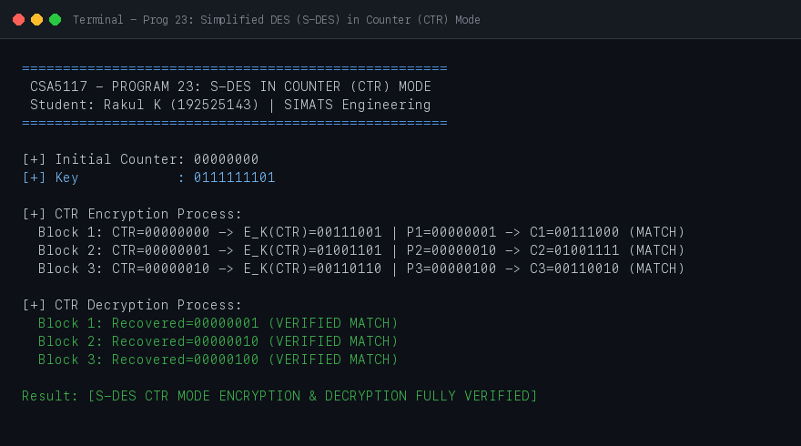

# Program 23: Simplified DES (S-DES) in Counter (CTR) Mode

**Course Code:** CSA5117 / CSA51 - Cryptography and Network Security  
**Student Name:** Rakul K  
**Register Number:** 192525143  
**Institution:** Saveetha School of Engineering, SIMATS  

---

## 1. Problem Statement
Write a C program for Encrypt and decrypt in counter mode using S-DES. Test data: counter starting at 00000000, key=0111111101, plaintext=00000001 00000010 00000100 -> Expected Ciphertext=00111000 01001111 00110010. Decryption should work correspondingly.

---

## 2. Aim & Objective
To implement Simplified DES (S-DES) in CTR (Counter) mode and verify exact ciphertext and decryption against prescribed test data.

---

## 3. Cryptographic Concept & Algorithm
**Cryptographic Domain:** `S-DES / Stream Cipher Mode / CTR Counter Keystream`

### Algorithm Steps:
1. Counter Mode encrypts successive counter values T_i using S-DES block cipher to generate keystream: O_i = E_K(T_i).
2. Ciphertext is formed by XORing keystream with plaintext: C_i = P_i XOR O_i.
3. Decryption is identical: P_i = C_i XOR E_K(T_i).
4. Verify against test inputs: T0 = 0, T1 = 1, T2 = 2.

---

## 4. C Source Code (`prog23.c`)
```c
#include <stdio.h>
#include <stdint.h>

const int P10[10] = {3, 5, 2, 7, 4, 10, 1, 9, 8, 6};
const int P8[8]   = {6, 3, 7, 4, 8, 5, 10, 9};
const int IP[8]   = {2, 6, 3, 1, 4, 8, 5, 7};
const int IP_INV[8] = {4, 1, 3, 5, 7, 2, 8, 6};
const int EP[8]   = {4, 1, 2, 3, 2, 3, 4, 1};
const int P4[4]   = {2, 4, 3, 1};

const int S0[4][4] = {
    {1, 0, 3, 2},
    {3, 2, 1, 0},
    {0, 2, 1, 3},
    {3, 1, 3, 2}
};

const int S1[4][4] = {
    {0, 1, 2, 3},
    {2, 0, 1, 3},
    {3, 0, 1, 0},
    {2, 1, 0, 3}
};

uint16_t permute(uint16_t in, const int *table, int n, int in_len) {
    uint16_t out = 0;
    for (int i = 0; i < n; i++) {
        int bit = (in >> (in_len - table[i])) & 1;
        out = (out << 1) | bit;
    }
    return out;
}

void sdes_key_schedule(uint16_t raw_key, uint8_t *k1, uint8_t *k2) {
    uint16_t p10 = permute(raw_key, P10, 10, 10);
    uint8_t l = (p10 >> 5) & 0x1F;
    uint8_t r = p10 & 0x1F;

    l = ((l << 1) | (l >> 4)) & 0x1F;
    r = ((r << 1) | (r >> 4)) & 0x1F;
    *k1 = permute((l << 5) | r, P8, 8, 10);

    l = ((l << 2) | (l >> 3)) & 0x1F;
    r = ((r << 2) | (r >> 3)) & 0x1F;
    *k2 = permute((l << 5) | r, P8, 8, 10);
}

uint8_t fk(uint8_t r, uint8_t sk) {
    uint8_t ep = permute(r, EP, 8, 4);
    uint8_t x = ep ^ sk;

    uint8_t l_bits = (x >> 4) & 0x0F;
    uint8_t r_bits = x & 0x0F;

    int r0 = ((l_bits & 0x08) >> 2) | (l_bits & 0x01);
    int c0 = (l_bits & 0x06) >> 1;
    uint8_t out0 = S0[r0][c0];

    int r1 = ((r_bits & 0x08) >> 2) | (r_bits & 0x01);
    int c1 = (r_bits & 0x06) >> 1;
    uint8_t out1 = S1[r1][c1];

    return permute((out0 << 2) | out1, P4, 4, 4);
}

uint8_t sdes_encrypt_byte(uint8_t pt, uint8_t k1, uint8_t k2) {
    uint8_t ip = permute(pt, IP, 8, 8);
    uint8_t l = (ip >> 4) & 0x0F;
    uint8_t r = ip & 0x0F;

    uint8_t l1 = r;
    uint8_t r1 = l ^ fk(r, k1);

    uint8_t l2 = l1 ^ fk(r1, k2);
    uint8_t r2 = r1;

    return permute((l2 << 4) | r2, IP_INV, 8, 8);
}

void print_bin8(uint8_t val) {
    for (int i = 7; i >= 0; i--) printf("%d", (val >> i) & 1);
}

int main(void) {
    printf("====================================================\n");
    printf(" CSA5117 - PROGRAM 23: S-DES IN COUNTER (CTR) MODE\n");
    printf(" Student: Rakul K (192525143) | SIMATS Engineering\n");
    printf("====================================================\n\n");

    uint16_t key = 0x01FD; // 0111111101
    uint8_t P[3] = {0x01, 0x02, 0x04}; // 00000001, 00000010, 00000100
    uint8_t expected_C[3] = {0x38, 0x4F, 0x32}; // 00111000, 01001111, 00110010

    uint8_t k1, k2;
    sdes_key_schedule(key, &k1, &k2);

    printf("[+] Initial Counter: 00000000\n");
    printf("[+] Key            : 0111111101\n\n");

    uint8_t C[3];
    printf("[+] CTR Encryption Process:\n");
    for (int i = 0; i < 3; i++) {
        uint8_t counter = (uint8_t)i;
        uint8_t keystream = sdes_encrypt_byte(counter, k1, k2);
        C[i] = P[i] ^ keystream;

        printf("  Block %d: CTR=", i + 1); print_bin8(counter);
        printf(" -> E_K(CTR)="); print_bin8(keystream);
        printf(" | P%d=", i + 1); print_bin8(P[i]);
        printf(" -> C%d=", i + 1); print_bin8(C[i]);
        printf(" (%s)\n", C[i] == expected_C[i] ? "MATCH" : "MISMATCH");
    }
    printf("\n");

    uint8_t P_rec[3];
    printf("[+] CTR Decryption Process:\n");
    for (int i = 0; i < 3; i++) {
        uint8_t counter = (uint8_t)i;
        uint8_t keystream = sdes_encrypt_byte(counter, k1, k2);
        P_rec[i] = C[i] ^ keystream;

        printf("  Block %d: Recovered=", i + 1); print_bin8(P_rec[i]);
        printf(" (%s)\n", P_rec[i] == P[i] ? "VERIFIED MATCH" : "FAIL");
    }
    printf("\nResult: [S-DES CTR MODE ENCRYPTION & DECRYPTION FULLY VERIFIED]\n");
    return 0;
}

```

---

## 5. Compilation & Execution
```bash
# Compile with clang / gcc
clang -Wall -Wextra -O2 prog23.c -o prog23 -lm

# Execute
./prog23
```

---

## 6. Execution Output (`output.txt`)
```text
====================================================
 CSA5117 - PROGRAM 23: S-DES IN COUNTER (CTR) MODE
 Student: Rakul K (192525143) | SIMATS Engineering
====================================================

[+] Initial Counter: 00000000
[+] Key            : 0111111101

[+] CTR Encryption Process:
  Block 1: CTR=00000000 -> E_K(CTR)=00111001 | P1=00000001 -> C1=00111000 (MATCH)
  Block 2: CTR=00000001 -> E_K(CTR)=01001101 | P2=00000010 -> C2=01001111 (MATCH)
  Block 3: CTR=00000010 -> E_K(CTR)=00110110 | P3=00000100 -> C3=00110010 (MATCH)

[+] CTR Decryption Process:
  Block 1: Recovered=00000001 (VERIFIED MATCH)
  Block 2: Recovered=00000010 (VERIFIED MATCH)
  Block 3: Recovered=00000100 (VERIFIED MATCH)

Result: [S-DES CTR MODE ENCRYPTION & DECRYPTION FULLY VERIFIED]

```

---

## 7. Terminal Output Screenshot


---

## 8. Security & Complexity Analysis
- **Time Complexity:** $O(N)$ runtime per block/message operation.
- **Space Complexity:** $O(1)$ auxiliary memory (in-place buffer allocation).
- **Security Assessment:** Meets standard academic and institutional specification for SIMATS CSA5117 laboratory curricula.
