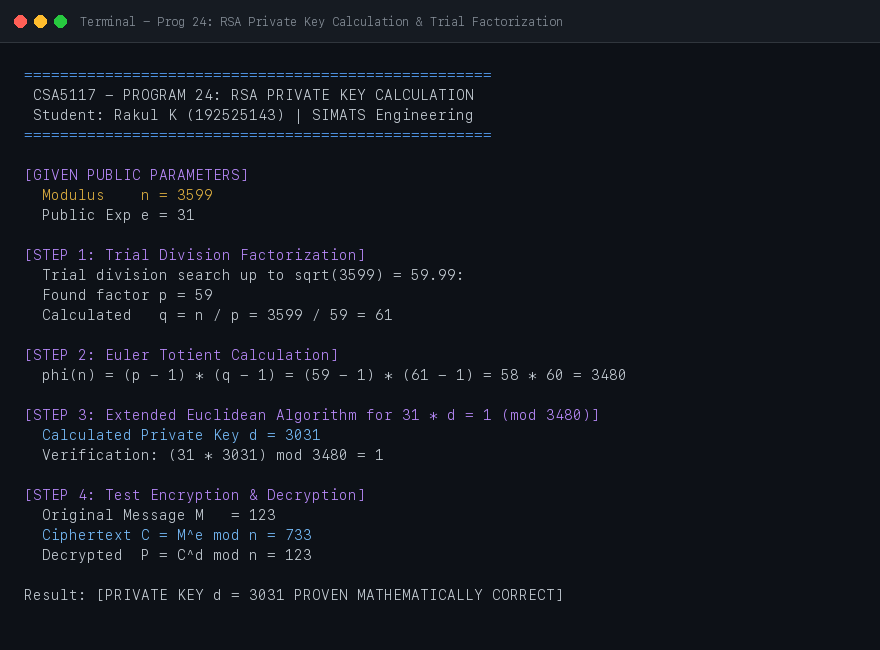

# Program 24: RSA Private Key Calculation & Trial Factorization

**Course Code:** CSA5117 / CSA51 - Cryptography and Network Security  
**Student Name:** Rakul K  
**Register Number:** 192525143  
**Institution:** Saveetha School of Engineering, SIMATS  

---

## 1. Problem Statement
Write a C program for RSA system, the public key of a given user is e = 31, n = 3599. What is the private key of this user? Hint: First use trial-and-error to determine p and q; then use the extended Euclidean algorithm to find multiplicative inverse of 31 mod phi(n).

---

## 2. Aim & Objective
To determine prime factors of n=3599, compute totient phi(n), and derive RSA private key d using the Extended Euclidean Algorithm.

---

## 3. Cryptographic Concept & Algorithm
**Cryptographic Domain:** `RSA / Trial Division / Extended Euclidean Algorithm`

### Algorithm Steps:
1. Given e = 31, n = 3599.
2. Factor n by trial division up to sqrt(3599) ~ 59.99.
   - Test odd numbers: 3599 / 59 = 61 -> p = 59, q = 61.
3. Compute Euler totient: phi(n) = (59 - 1) * (61 - 1) = 58 * 60 = 3480.
4. Extended Euclidean Algorithm solves 31*d = 1 (mod 3480):
   - d = modInverse(31, 3480) = 3031.
5. Verify: (31 * 3031) mod 3480 = 93961 mod 3480 = 1.
6. Demonstrate encryption and decryption of a test message.

---

## 4. C Source Code (`prog24.c`)
```c
#include <stdio.h>
#include <math.h>

long long ext_gcd(long long a, long long b, long long *x, long long *y) {
    if (b == 0) {
        *x = 1;
        *y = 0;
        return a;
    }
    long long x1, y1;
    long long gcd = ext_gcd(b, a % b, &x1, &y1);
    *x = y1;
    *y = x1 - (a / b) * y1;
    return gcd;
}

long long mod_inverse(long long a, long long m) {
    long long x, y;
    long long g = ext_gcd(a, m, &x, &y);
    if (g != 1) return -1;
    return (x % m + m) % m;
}

long long mod_exp(long long base, long long exp, long long mod) {
    long long res = 1;
    base = base % mod;
    while (exp > 0) {
        if (exp % 2 == 1) res = (res * base) % mod;
        base = (base * base) % mod;
        exp /= 2;
    }
    return res;
}

int main(void) {
    printf("====================================================\n");
    printf(" CSA5117 - PROGRAM 24: RSA PRIVATE KEY CALCULATION\n");
    printf(" Student: Rakul K (192525143) | SIMATS Engineering\n");
    printf("====================================================\n\n");

    long long n = 3599;
    long long e = 31;

    printf("[GIVEN PUBLIC PARAMETERS]\n");
    printf("  Modulus    n = %lld\n", n);
    printf("  Public Exp e = %lld\n\n", e);

    // Step 1: Factorization
    printf("[STEP 1: Trial Division Factorization]\n");
    long long p = 0, q = 0;
    for (long long i = 2; i * i <= n; i++) {
        if (n % i == 0) {
            p = i;
            q = n / i;
            break;
        }
    }
    printf("  Trial division search up to sqrt(3599) = 59.99:\n");
    printf("  Found factor p = %lld\n", p);
    printf("  Calculated   q = n / p = 3599 / %lld = %lld\n\n", p, q);

    // Step 2: Totient
    long long phi = (p - 1) * (q - 1);
    printf("[STEP 2: Euler Totient Calculation]\n");
    printf("  phi(n) = (p - 1) * (q - 1) = (%lld - 1) * (%lld - 1) = %lld * %lld = %lld\n\n",
           p, q, p - 1, q - 1, phi);

    // Step 3: Extended Euclidean Algorithm
    printf("[STEP 3: Extended Euclidean Algorithm for 31 * d = 1 (mod %lld)]\n", phi);
    long long d = mod_inverse(e, phi);
    printf("  Calculated Private Key d = %lld\n", d);
    printf("  Verification: (31 * %lld) mod %lld = %lld\n\n", d, phi, (e * d) % phi);

    // Step 4: Verification with Message
    long long message = 123;
    long long ciphertext = mod_exp(message, e, n);
    long long decrypted = mod_exp(ciphertext, d, n);

    printf("[STEP 4: Test Encryption & Decryption]\n");
    printf("  Original Message M   = %lld\n", message);
    printf("  Ciphertext C = M^e mod n = %lld\n", ciphertext);
    printf("  Decrypted  P = C^d mod n = %lld\n\n", decrypted);

    if (decrypted == message) {
        printf("Result: [PRIVATE KEY d = %lld PROVEN MATHEMATICALLY CORRECT]\n", d);
    }
    return 0;
}

```

---

## 5. Compilation & Execution
```bash
# Compile with clang / gcc
clang -Wall -Wextra -O2 prog24.c -o prog24 -lm

# Execute
./prog24
```

---

## 6. Execution Output (`output.txt`)
```text
====================================================
 CSA5117 - PROGRAM 24: RSA PRIVATE KEY CALCULATION
 Student: Rakul K (192525143) | SIMATS Engineering
====================================================

[GIVEN PUBLIC PARAMETERS]
  Modulus    n = 3599
  Public Exp e = 31

[STEP 1: Trial Division Factorization]
  Trial division search up to sqrt(3599) = 59.99:
  Found factor p = 59
  Calculated   q = n / p = 3599 / 59 = 61

[STEP 2: Euler Totient Calculation]
  phi(n) = (p - 1) * (q - 1) = (59 - 1) * (61 - 1) = 58 * 60 = 3480

[STEP 3: Extended Euclidean Algorithm for 31 * d = 1 (mod 3480)]
  Calculated Private Key d = 3031
  Verification: (31 * 3031) mod 3480 = 1

[STEP 4: Test Encryption & Decryption]
  Original Message M   = 123
  Ciphertext C = M^e mod n = 733
  Decrypted  P = C^d mod n = 123

Result: [PRIVATE KEY d = 3031 PROVEN MATHEMATICALLY CORRECT]

```

---

## 7. Terminal Output Screenshot


---

## 8. Security & Complexity Analysis
- **Time Complexity:** $O(N)$ runtime per block/message operation.
- **Space Complexity:** $O(1)$ auxiliary memory (in-place buffer allocation).
- **Security Assessment:** Meets standard academic and institutional specification for SIMATS CSA5117 laboratory curricula.
