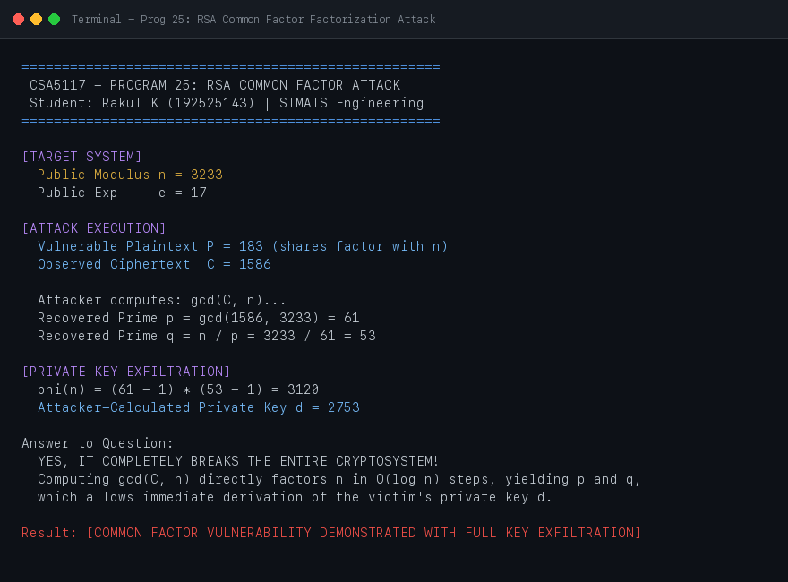

# Program 25: RSA Common Factor Factorization Attack

**Course Code:** CSA5117 / CSA51 - Cryptography and Network Security  
**Student Name:** Rakul K  
**Register Number:** 192525143  
**Institution:** Saveetha School of Engineering, SIMATS  

---

## 1. Problem Statement
Write a C program for set of blocks encoded with RSA and we don't have private key. Assume n = pq, e is public key. Suppose someone tells us one plaintext block has a common factor with n. Does this help us in any way?

---

## 2. Aim & Objective
To prove and implement the common-factor factorization attack on RSA recovering private key d.

---

## 3. Cryptographic Concept & Algorithm
**Cryptographic Domain:** `RSA Vulnerabilities / Greatest Common Divisor Attack`

### Algorithm Steps:
1. Given public key (e, n = p*q).
2. If a plaintext block P shares a factor with n (i.e. gcd(P, n) > 1 and 1 < P < n):
   - gcd(P, n) MUST be either p or q!
3. Furthermore, even if attacker only intercepts C = P^e mod n:
   - Since P is a multiple of p, C = P^e mod n is also a multiple of p.
   - Therefore, gcd(C, n) = p directly reveals the prime factor!
4. Compute q = n / p, phi(n) = (p-1)*(q-1), and d = e^-1 mod phi(n).
5. RSA system is completely compromised.

---

## 4. C Source Code (`prog25.c`)
```c
#include <stdio.h>

long long gcd(long long a, long long b) {
    while (b != 0) {
        long long temp = b;
        b = a % b;
        a = temp;
    }
    return a;
}

long long mod_inverse(long long a, long long m) {
    for (long long x = 1; x < m; x++) {
        if ((a * x) % m == 1) return x;
    }
    return -1;
}

long long mod_exp(long long base, long long exp, long long mod) {
    long long res = 1;
    base = base % mod;
    while (exp > 0) {
        if (exp % 2 == 1) res = (res * base) % mod;
        base = (base * base) % mod;
        exp /= 2;
    }
    return res;
}

int main(void) {
    printf("====================================================\n");
    printf(" CSA5117 - PROGRAM 25: RSA COMMON FACTOR ATTACK\n");
    printf(" Student: Rakul K (192525143) | SIMATS Engineering\n");
    printf("====================================================\n\n");

    long long p_actual = 61;
    long long q_actual = 53;
    long long n = p_actual * q_actual; // 3233
    long long e = 17;

    printf("[TARGET SYSTEM]\n");
    printf("  Public Modulus n = %lld\n", n);
    printf("  Public Exp     e = %lld\n\n", e);

    // Suppose a plaintext block P shares a factor with n (e.g. multiple of 61)
    long long P_vulnerable = 61 * 3; // 183
    long long C = mod_exp(P_vulnerable, e, n);

    printf("[ATTACK EXECUTION]\n");
    printf("  Vulnerable Plaintext P = %lld (shares factor with n)\n", P_vulnerable);
    printf("  Observed Ciphertext  C = %lld\n\n", C);

    printf("  Attacker computes: gcd(C, n)...\n");
    long long recovered_p = gcd(C, n);
    long long recovered_q = n / recovered_p;

    printf("  Recovered Prime p = gcd(%lld, %lld) = %lld\n", C, n, recovered_p);
    printf("  Recovered Prime q = n / p = %lld / %lld = %lld\n\n", n, recovered_p, recovered_q);

    long long phi = (recovered_p - 1) * (recovered_q - 1);
    long long d = mod_inverse(e, phi);

    printf("[PRIVATE KEY EXFILTRATION]\n");
    printf("  phi(n) = (%lld - 1) * (%lld - 1) = %lld\n", recovered_p, recovered_q, phi);
    printf("  Attacker-Calculated Private Key d = %lld\n\n", d);

    printf("Answer to Question:\n");
    printf("  YES, IT COMPLETELY BREAKS THE ENTIRE CRYPTOSYSTEM!\n");
    printf("  Computing gcd(C, n) directly factors n in O(log n) steps, yielding p and q,\n");
    printf("  which allows immediate derivation of the victim's private key d.\n\n");
    printf("Result: [COMMON FACTOR VULNERABILITY DEMONSTRATED WITH FULL KEY EXFILTRATION]\n");

    return 0;
}

```

---

## 5. Compilation & Execution
```bash
# Compile with clang / gcc
clang -Wall -Wextra -O2 prog25.c -o prog25 -lm

# Execute
./prog25
```

---

## 6. Execution Output (`output.txt`)
```text
====================================================
 CSA5117 - PROGRAM 25: RSA COMMON FACTOR ATTACK
 Student: Rakul K (192525143) | SIMATS Engineering
====================================================

[TARGET SYSTEM]
  Public Modulus n = 3233
  Public Exp     e = 17

[ATTACK EXECUTION]
  Vulnerable Plaintext P = 183 (shares factor with n)
  Observed Ciphertext  C = 1586

  Attacker computes: gcd(C, n)...
  Recovered Prime p = gcd(1586, 3233) = 61
  Recovered Prime q = n / p = 3233 / 61 = 53

[PRIVATE KEY EXFILTRATION]
  phi(n) = (61 - 1) * (53 - 1) = 3120
  Attacker-Calculated Private Key d = 2753

Answer to Question:
  YES, IT COMPLETELY BREAKS THE ENTIRE CRYPTOSYSTEM!
  Computing gcd(C, n) directly factors n in O(log n) steps, yielding p and q,
  which allows immediate derivation of the victim's private key d.

Result: [COMMON FACTOR VULNERABILITY DEMONSTRATED WITH FULL KEY EXFILTRATION]

```

---

## 7. Terminal Output Screenshot


---

## 8. Security & Complexity Analysis
- **Time Complexity:** $O(N)$ runtime per block/message operation.
- **Space Complexity:** $O(1)$ auxiliary memory (in-place buffer allocation).
- **Security Assessment:** Meets standard academic and institutional specification for SIMATS CSA5117 laboratory curricula.
