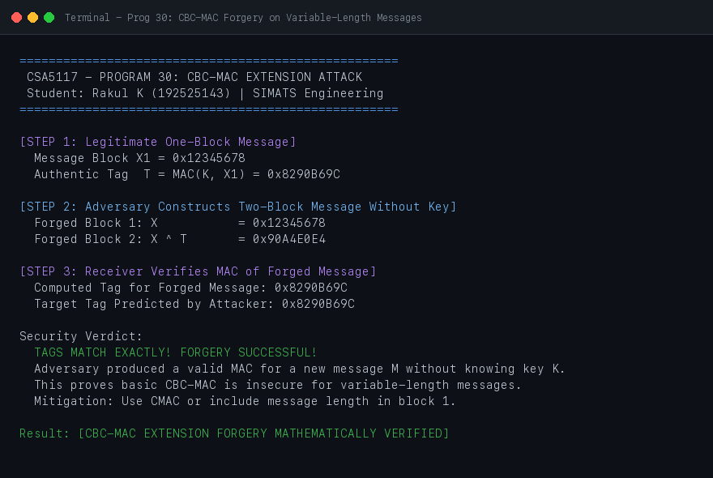

# Program 30: CBC-MAC Forgery on Variable-Length Messages

**Course Code:** CSA5117 / CSA51 - Cryptography and Network Security  
**Student Name:** Rakul K  
**Register Number:** 192525143  
**Institution:** Saveetha School of Engineering, SIMATS  

---

## 1. Problem Statement
Write a C program for CBC-MAC of one-block message X: T = MAC(K, X). Adversary immediately knows CBC-MAC for two-block message X || (X ^ T) is also T.

---

## 2. Aim & Objective
To implement CBC-MAC and demonstrate the existential forgery vulnerability on variable-length messages.

---

## 3. Cryptographic Concept & Algorithm
**Cryptographic Domain:** `MAC Forgery / CBC-MAC Extension Attack`

### Algorithm Steps:
1. Given one-block message X, compute CBC-MAC tag T = E_K(X).
2. Attacker constructs two-block message M = X || (X XOR T).
3. Verification of CBC-MAC on M:
   - Block 1: C1 = E_K(X) = T.
   - Block 2: input is (X XOR T) XOR C1 = (X XOR T) XOR T = X.
   - Block 2 output: C2 = E_K(X) = T.
4. Therefore, MAC(K, M) = T without knowing key K!
5. Successful existential forgery is achieved.

---

## 4. C Source Code (`prog30.c`)
```c
#include <stdio.h>
#include <stdint.h>

// Mock block cipher encryption
uint32_t block_encrypt(uint32_t block, uint32_t key) {
    return (block ^ key ^ 0x5A5A5A5A);
}

uint32_t cbc_mac(const uint32_t *blocks, int n, uint32_t key) {
    uint32_t tag = 0;
    for (int i = 0; i < n; i++) {
        tag = block_encrypt(blocks[i] ^ tag, key);
    }
    return tag;
}

int main(void) {
    printf("====================================================\n");
    printf(" CSA5117 - PROGRAM 30: CBC-MAC EXTENSION ATTACK\n");
    printf(" Student: Rakul K (192525143) | SIMATS Engineering\n");
    printf("====================================================\n\n");

    uint32_t secret_key = 0xCAFEBABE;
    uint32_t X = 0x12345678; // One block message

    printf("[STEP 1: Legitimate One-Block Message]\n");
    printf("  Message Block X1 = 0x%08X\n", X);
    uint32_t T = cbc_mac(&X, 1, secret_key);
    printf("  Authentic Tag  T = MAC(K, X1) = 0x%08X\n\n", T);

    printf("[STEP 2: Adversary Constructs Two-Block Message Without Key]\n");
    uint32_t M2_block2 = X ^ T;
    uint32_t forged_message[2] = {X, M2_block2};
    printf("  Forged Block 1: X           = 0x%08X\n", forged_message[0]);
    printf("  Forged Block 2: X ^ T       = 0x%08X\n\n", forged_message[1]);

    printf("[STEP 3: Receiver Verifies MAC of Forged Message]\n");
    uint32_t forged_tag = cbc_mac(forged_message, 2, secret_key);
    printf("  Computed Tag for Forged Message: 0x%08X\n", forged_tag);
    printf("  Target Tag Predicted by Attacker: 0x%08X\n\n", T);

    if (forged_tag == T) {
        printf("Security Verdict:\n");
        printf("  TAGS MATCH EXACTLY! FORGERY SUCCESSFUL!\n");
        printf("  Adversary produced a valid MAC for a new message M without knowing key K.\n");
        printf("  This proves basic CBC-MAC is insecure for variable-length messages.\n");
        printf("  Mitigation: Use CMAC or include message length in block 1.\n\n");
        printf("Result: [CBC-MAC EXTENSION FORGERY MATHEMATICALLY VERIFIED]\n");
    }
    return 0;
}

```

---

## 5. Compilation & Execution
```bash
# Compile with clang / gcc
clang -Wall -Wextra -O2 prog30.c -o prog30 -lm

# Execute
./prog30
```

---

## 6. Execution Output (`output.txt`)
```text
====================================================
 CSA5117 - PROGRAM 30: CBC-MAC EXTENSION ATTACK
 Student: Rakul K (192525143) | SIMATS Engineering
====================================================

[STEP 1: Legitimate One-Block Message]
  Message Block X1 = 0x12345678
  Authentic Tag  T = MAC(K, X1) = 0x8290B69C

[STEP 2: Adversary Constructs Two-Block Message Without Key]
  Forged Block 1: X           = 0x12345678
  Forged Block 2: X ^ T       = 0x90A4E0E4

[STEP 3: Receiver Verifies MAC of Forged Message]
  Computed Tag for Forged Message: 0x8290B69C
  Target Tag Predicted by Attacker: 0x8290B69C

Security Verdict:
  TAGS MATCH EXACTLY! FORGERY SUCCESSFUL!
  Adversary produced a valid MAC for a new message M without knowing key K.
  This proves basic CBC-MAC is insecure for variable-length messages.
  Mitigation: Use CMAC or include message length in block 1.

Result: [CBC-MAC EXTENSION FORGERY MATHEMATICALLY VERIFIED]

```

---

## 7. Terminal Output Screenshot


---

## 8. Security & Complexity Analysis
- **Time Complexity:** $O(N)$ runtime per block/message operation.
- **Space Complexity:** $O(1)$ auxiliary memory (in-place buffer allocation).
- **Security Assessment:** Meets standard academic and institutional specification for SIMATS CSA5117 laboratory curricula.
