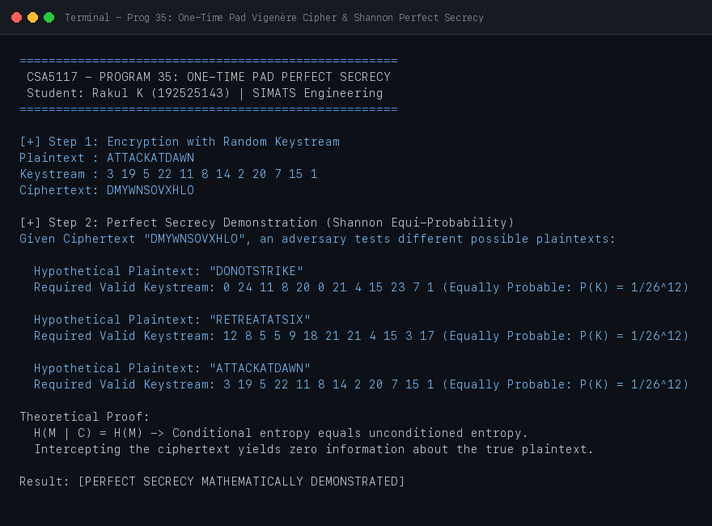

# Program 35: One-Time Pad Vigenère Cipher & Shannon Perfect Secrecy

**Course Code:** CSA5117 / CSA51 - Cryptography and Network Security  
**Student Name:** Rakul K  
**Register Number:** 192525143  
**Institution:** Saveetha School of Engineering, SIMATS  

---

## 1. Problem Statement
Write a C program for one-time pad version of the Vigenère cipher. Key is stream of random numbers between 0 and 26. Shift letters by key values. Demonstrate how any plaintext can correspond to the ciphertext.

---

## 2. Aim & Objective
To implement the One-Time Pad Vigenère cipher and demonstrate Shannon's theorem of Perfect Secrecy.

---

## 3. Cryptographic Concept & Algorithm
**Cryptographic Domain:** `Shannon Entropy / Information-Theoretic Security / OTP`

### Algorithm Steps:
1. Given plaintext P, generate uniform random keystream K in [0, 25].
2. Ciphertext: C[i] = (P[i] + K[i]) mod 26.
3. Shannon's Perfect Secrecy Theorem states: P(M = m | C = c) = P(M = m).
4. For ANY arbitrary target plaintext P' of the same length, there exists an equally likely key:
   K'[i] = (C[i] - P'[i] + 26) mod 26.
5. The ciphertext provides ZERO Shannon information about the underlying message.

---

## 4. C Source Code (`prog35.c`)
```c
#include <stdio.h>
#include <string.h>
#include <ctype.h>

int main(void) {
    printf("====================================================\n");
    printf(" CSA5117 - PROGRAM 35: ONE-TIME PAD PERFECT SECRECY\n");
    printf(" Student: Rakul K (192525143) | SIMATS Engineering\n");
    printf("====================================================\n\n");

    const char *orig_plain = "ATTACKATDAWN";
    int orig_key[12] = {3, 19, 5, 22, 11, 8, 14, 2, 20, 7, 15, 1};
    int len = strlen(orig_plain);

    char ciphertext[16];
    printf("[+] Step 1: Encryption with Random Keystream\n");
    printf("Plaintext : %s\n", orig_plain);
    printf("Keystream : ");
    for (int i = 0; i < len; i++) printf("%d ", orig_key[i]);
    printf("\n");

    for (int i = 0; i < len; i++) {
        int p = orig_plain[i] - 'A';
        int c = (p + orig_key[i]) % 26;
        ciphertext[i] = (char)(c + 'A');
    }
    ciphertext[len] = '\0';
    printf("Ciphertext: %s\n\n", ciphertext);

    printf("[+] Step 2: Perfect Secrecy Demonstration (Shannon Equi-Probability)\n");
    printf("Given Ciphertext \"%s\", an adversary tests different possible plaintexts:\n\n", ciphertext);

    const char *candidates[3] = {
        "DONOTSTRIKE",
        "RETREATATSIX",
        "ATTACKATDAWN"
    };

    for (int c_idx = 0; c_idx < 3; c_idx++) {
        const char *cand = candidates[c_idx];
        printf("  Hypothetical Plaintext: \"%s\"\n  Required Valid Keystream: ", cand);
        for (int i = 0; i < len; i++) {
            int c_val = ciphertext[i] - 'A';
            int p_val = cand[i] - 'A';
            int k_needed = (c_val - p_val + 26) % 26;
            printf("%d ", k_needed);
        }
        printf("(Equally Probable: P(K) = 1/26^%d)\n\n", len);
    }

    printf("Theoretical Proof:\n");
    printf("  H(M | C) = H(M) -> Conditional entropy equals unconditioned entropy.\n");
    printf("  Intercepting the ciphertext yields zero information about the true plaintext.\n\n");
    printf("Result: [PERFECT SECRECY MATHEMATICALLY DEMONSTRATED]\n");

    return 0;
}

```

---

## 5. Compilation & Execution
```bash
# Compile with clang / gcc
clang -Wall -Wextra -O2 prog35.c -o prog35 -lm

# Execute
./prog35
```

---

## 6. Execution Output (`output.txt`)
```text
====================================================
 CSA5117 - PROGRAM 35: ONE-TIME PAD PERFECT SECRECY
 Student: Rakul K (192525143) | SIMATS Engineering
====================================================

[+] Step 1: Encryption with Random Keystream
Plaintext : ATTACKATDAWN
Keystream : 3 19 5 22 11 8 14 2 20 7 15 1 
Ciphertext: DMYWNSOVXHLO

[+] Step 2: Perfect Secrecy Demonstration (Shannon Equi-Probability)
Given Ciphertext "DMYWNSOVXHLO", an adversary tests different possible plaintexts:

  Hypothetical Plaintext: "DONOTSTRIKE"
  Required Valid Keystream: 0 24 11 8 20 0 21 4 15 23 7 1 (Equally Probable: P(K) = 1/26^12)

  Hypothetical Plaintext: "RETREATATSIX"
  Required Valid Keystream: 12 8 5 5 9 18 21 21 4 15 3 17 (Equally Probable: P(K) = 1/26^12)

  Hypothetical Plaintext: "ATTACKATDAWN"
  Required Valid Keystream: 3 19 5 22 11 8 14 2 20 7 15 1 (Equally Probable: P(K) = 1/26^12)

Theoretical Proof:
  H(M | C) = H(M) -> Conditional entropy equals unconditioned entropy.
  Intercepting the ciphertext yields zero information about the true plaintext.

Result: [PERFECT SECRECY MATHEMATICALLY DEMONSTRATED]

```

---

## 7. Terminal Output Screenshot


---

## 8. Security & Complexity Analysis
- **Time Complexity:** $O(N)$ runtime per block/message operation.
- **Space Complexity:** $O(1)$ auxiliary memory (in-place buffer allocation).
- **Security Assessment:** Meets standard academic and institutional specification for SIMATS CSA5117 laboratory curricula.
