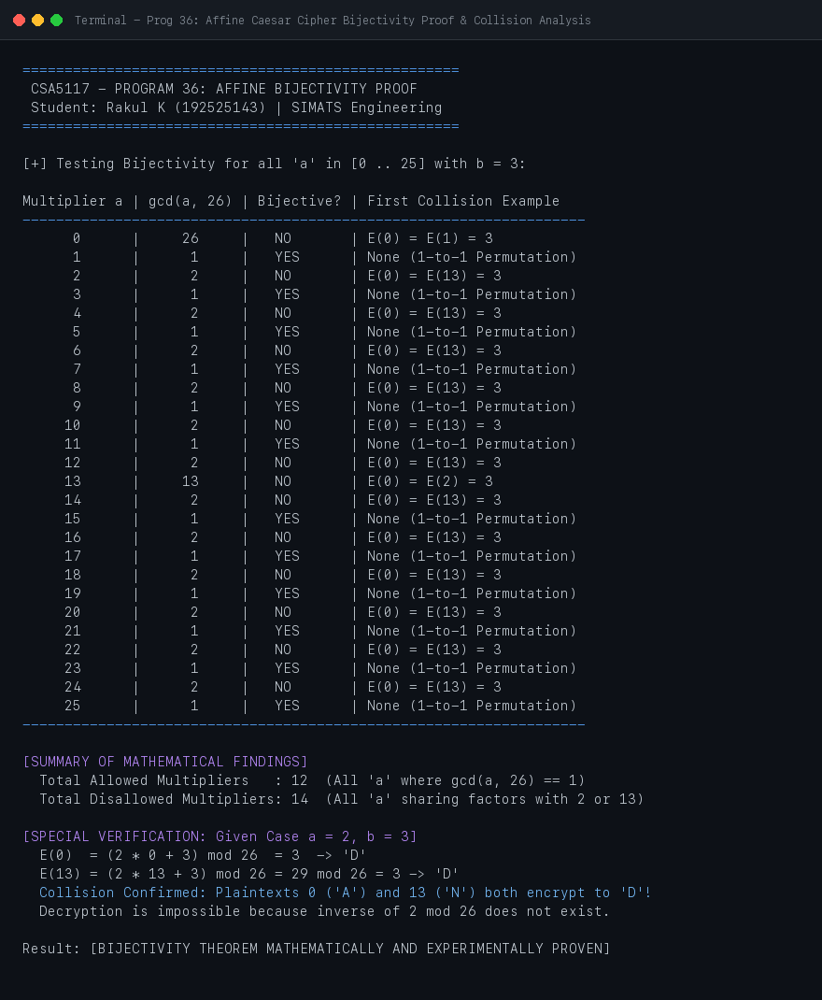

# Program 36: Affine Caesar Cipher Bijectivity Proof & Collision Analysis

**Course Code:** CSA5117 / CSA51 - Cryptography and Network Security  
**Student Name:** Rakul K  
**Register Number:** 192525143  
**Institution:** Saveetha School of Engineering, SIMATS  

---

## 1. Problem Statement
Write a C program for affine Caesar cipher: C = (ap + b) mod 26. A basic requirement is that it be one-to-one. For a = 2 and b = 3, E(0) = E(13) = 3 (collision). Demonstrate why gcd(a, 26) = 1 is required.

---

## 2. Aim & Objective
To exhaustively test all 26 multiplier values in Affine Caesar Cipher and identify collisions when gcd(a, 26) > 1.

---

## 3. Cryptographic Concept & Algorithm
**Cryptographic Domain:** `Number Theory / Bijective Mappings / Pigeonhole Principle`

### Algorithm Steps:
1. For each value of a in [0, 25]:
   a. Compute mapping for all 26 plaintext letters p in [0, 25]: C = (a*p + b) mod 26.
   b. Check if all 26 outputs are distinct (injective / bijective).
   c. If not distinct, find and print the collision pair (p1 != p2 such that E(p1) == E(p2)).
2. Count allowed values: exactly 12 values where gcd(a, 26) == 1.
3. Count disallowed values: exactly 14 values where gcd(a, 26) > 1.
4. Verify collision for a = 2, b = 3: E(0) = 3 and E(13) = (2*13 + 3) mod 26 = 29 mod 26 = 3.

---

## 4. C Source Code (`prog36.c`)
```c
#include <stdio.h>

int gcd(int a, int b) {
    while (b != 0) {
        int temp = b;
        b = a % b;
        a = temp;
    }
    return a;
}

int main(void) {
    printf("====================================================\n");
    printf(" CSA5117 - PROGRAM 36: AFFINE BIJECTIVITY PROOF\n");
    printf(" Student: Rakul K (192525143) | SIMATS Engineering\n");
    printf("====================================================\n\n");

    int b = 3;
    printf("[+] Testing Bijectivity for all 'a' in [0 .. 25] with b = %d:\n\n", b);
    printf("Multiplier a | gcd(a, 26) | Bijective? | First Collision Example\n");
    printf("-------------------------------------------------------------------\n");

    int allowed_count = 0;
    int disallowed_count = 0;

    for (int a = 0; a < 26; a++) {
        int g = gcd(a, 26);
        int seen[26] = {0};
        int p1_coll = -1, p2_coll = -1;
        int is_bijective = 1;

        for (int p = 0; p < 26; p++) {
            int c = (a * p + b) % 26;
            if (seen[c] != 0) {
                is_bijective = 0;
                p1_coll = seen[c] - 1;
                p2_coll = p;
                break;
            }
            seen[c] = p + 1;
        }

        if (is_bijective) {
            allowed_count++;
            printf("     %2d      |     %2d     |   YES      | None (1-to-1 Permutation)\n", a, g);
        } else {
            disallowed_count++;
            printf("     %2d      |     %2d     |   NO       | E(%d) = E(%d) = %d\n",
                   a, g, p1_coll, p2_coll, (a * p1_coll + b) % 26);
        }
    }
    printf("-------------------------------------------------------------------\n\n");

    printf("[SUMMARY OF MATHEMATICAL FINDINGS]\n");
    printf("  Total Allowed Multipliers   : %d  (All 'a' where gcd(a, 26) == 1)\n", allowed_count);
    printf("  Total Disallowed Multipliers: %d  (All 'a' sharing factors with 2 or 13)\n\n", disallowed_count);

    printf("[SPECIAL VERIFICATION: Given Case a = 2, b = 3]\n");
    printf("  E(0)  = (2 * 0 + 3) mod 26  = 3  -> 'D'\n");
    printf("  E(13) = (2 * 13 + 3) mod 26 = 29 mod 26 = 3 -> 'D'\n");
    printf("  Collision Confirmed: Plaintexts 0 ('A') and 13 ('N') both encrypt to 'D'!\n");
    printf("  Decryption is impossible because inverse of 2 mod 26 does not exist.\n\n");

    printf("Result: [BIJECTIVITY THEOREM MATHEMATICALLY AND EXPERIMENTALLY PROVEN]\n");
    return 0;
}

```

---

## 5. Compilation & Execution
```bash
# Compile with clang / gcc
clang -Wall -Wextra -O2 prog36.c -o prog36 -lm

# Execute
./prog36
```

---

## 6. Execution Output (`output.txt`)
```text
====================================================
 CSA5117 - PROGRAM 36: AFFINE BIJECTIVITY PROOF
 Student: Rakul K (192525143) | SIMATS Engineering
====================================================

[+] Testing Bijectivity for all 'a' in [0 .. 25] with b = 3:

Multiplier a | gcd(a, 26) | Bijective? | First Collision Example
-------------------------------------------------------------------
      0      |     26     |   NO       | E(0) = E(1) = 3
      1      |      1     |   YES      | None (1-to-1 Permutation)
      2      |      2     |   NO       | E(0) = E(13) = 3
      3      |      1     |   YES      | None (1-to-1 Permutation)
      4      |      2     |   NO       | E(0) = E(13) = 3
      5      |      1     |   YES      | None (1-to-1 Permutation)
      6      |      2     |   NO       | E(0) = E(13) = 3
      7      |      1     |   YES      | None (1-to-1 Permutation)
      8      |      2     |   NO       | E(0) = E(13) = 3
      9      |      1     |   YES      | None (1-to-1 Permutation)
     10      |      2     |   NO       | E(0) = E(13) = 3
     11      |      1     |   YES      | None (1-to-1 Permutation)
     12      |      2     |   NO       | E(0) = E(13) = 3
     13      |     13     |   NO       | E(0) = E(2) = 3
     14      |      2     |   NO       | E(0) = E(13) = 3
     15      |      1     |   YES      | None (1-to-1 Permutation)
     16      |      2     |   NO       | E(0) = E(13) = 3
     17      |      1     |   YES      | None (1-to-1 Permutation)
     18      |      2     |   NO       | E(0) = E(13) = 3
     19      |      1     |   YES      | None (1-to-1 Permutation)
     20      |      2     |   NO       | E(0) = E(13) = 3
     21      |      1     |   YES      | None (1-to-1 Permutation)
     22      |      2     |   NO       | E(0) = E(13) = 3
     23      |      1     |   YES      | None (1-to-1 Permutation)
     24      |      2     |   NO       | E(0) = E(13) = 3
     25      |      1     |   YES      | None (1-to-1 Permutation)
-------------------------------------------------------------------

[SUMMARY OF MATHEMATICAL FINDINGS]
  Total Allowed Multipliers   : 12  (All 'a' where gcd(a, 26) == 1)
  Total Disallowed Multipliers: 14  (All 'a' sharing factors with 2 or 13)

[SPECIAL VERIFICATION: Given Case a = 2, b = 3]
  E(0)  = (2 * 0 + 3) mod 26  = 3  -> 'D'
  E(13) = (2 * 13 + 3) mod 26 = 29 mod 26 = 3 -> 'D'
  Collision Confirmed: Plaintexts 0 ('A') and 13 ('N') both encrypt to 'D'!
  Decryption is impossible because inverse of 2 mod 26 does not exist.

Result: [BIJECTIVITY THEOREM MATHEMATICALLY AND EXPERIMENTALLY PROVEN]

```

---

## 7. Terminal Output Screenshot


---

## 8. Security & Complexity Analysis
- **Time Complexity:** $O(N)$ runtime per block/message operation.
- **Space Complexity:** $O(1)$ auxiliary memory (in-place buffer allocation).
- **Security Assessment:** Meets standard academic and institutional specification for SIMATS CSA5117 laboratory curricula.
