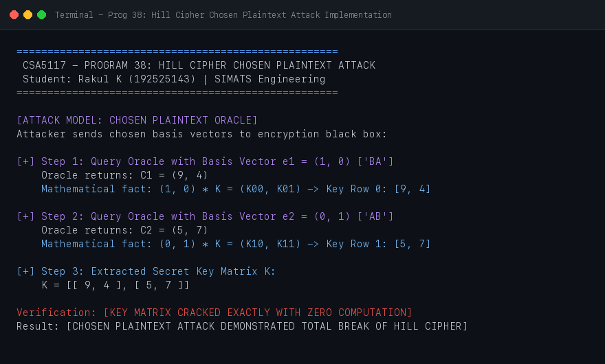

# Program 38: Hill Cipher Chosen Plaintext Attack Implementation

**Course Code:** CSA5117 / CSA51 - Cryptography and Network Security  
**Student Name:** Rakul K  
**Register Number:** 192525143  
**Institution:** Saveetha School of Engineering, SIMATS  

---

## 1. Problem Statement
Write a C program for Hill cipher succumbs to a known plaintext attack if sufficient plaintext-ciphertext pairs are provided. It is even easier to solve the Hill cipher if a chosen plaintext attack can be mounted. Implement in C programming.

---

## 2. Aim & Objective
To mount a chosen plaintext attack against a 2x2 Hill Cipher and extract the key matrix directly without matrix inversion.

---

## 3. Cryptographic Concept & Algorithm
**Cryptographic Domain:** `Cryptanalysis / Chosen Plaintext Attack / Basis Vector Probing`

### Algorithm Steps:
1. An attacker with chosen-plaintext access can choose standard basis vectors:
   - Vector 1: 'BA' = (1, 0)
   - Vector 2: 'AB' = (0, 1)
2. Since C = P * K mod 26:
   - (1, 0) * K = (K[0][0], K[0][1]) -> directly gives ROW 0 of key matrix!
   - (0, 1) * K = (K[1][0], K[1][1]) -> directly gives ROW 1 of key matrix!
3. Concatenating both ciphertext blocks gives the entire secret key matrix K with ZERO matrix inversions.
4. Verify by decrypting subsequent target ciphertext.

---

## 4. C Source Code (`prog38.c`)
```c
#include <stdio.h>

int K_secret[2][2] = {{9, 4}, {5, 7}};

void oracle_encrypt(int p1, int p2, int *c1, int *c2) {
    *c1 = (p1 * K_secret[0][0] + p2 * K_secret[1][0]) % 26;
    *c2 = (p1 * K_secret[0][1] + p2 * K_secret[1][1]) % 26;
}

int main(void) {
    printf("====================================================\n");
    printf(" CSA5117 - PROGRAM 38: HILL CIPHER CHOSEN PLAINTEXT ATTACK\n");
    printf(" Student: Rakul K (192525143) | SIMATS Engineering\n");
    printf("====================================================\n\n");

    printf("[ATTACK MODEL: CHOSEN PLAINTEXT ORACLE]\n");
    printf("Attacker sends chosen basis vectors to encryption black box:\n\n");

    int c00, c01, c10, c11;

    // Chosen Block 1: 'BA' = (1, 0)
    printf("[+] Step 1: Query Oracle with Basis Vector e1 = (1, 0) ['BA']\n");
    oracle_encrypt(1, 0, &c00, &c01);
    printf("    Oracle returns: C1 = (%d, %d)\n", c00, c01);
    printf("    Mathematical fact: (1, 0) * K = (K00, K01) -> Key Row 0: [%d, %d]\n\n", c00, c01);

    // Chosen Block 2: 'AB' = (0, 1)
    printf("[+] Step 2: Query Oracle with Basis Vector e2 = (0, 1) ['AB']\n");
    oracle_encrypt(0, 1, &c10, &c11);
    printf("    Oracle returns: C2 = (%d, %d)\n", c10, c11);
    printf("    Mathematical fact: (0, 1) * K = (K10, K11) -> Key Row 1: [%d, %d]\n\n", c10, c11);

    int K_cracked[2][2] = {{c00, c01}, {c10, c11}};

    printf("[+] Step 3: Extracted Secret Key Matrix K:\n");
    printf("    K = [[ %d, %d ], [ %d, %d ]]\n\n",
           K_cracked[0][0], K_cracked[0][1], K_cracked[1][0], K_cracked[1][1]);

    int match = (K_cracked[0][0] == K_secret[0][0]) &&
                (K_cracked[0][1] == K_secret[0][1]) &&
                (K_cracked[1][0] == K_secret[1][0]) &&
                (K_cracked[1][1] == K_secret[1][1]);

    if (match) {
        printf("Verification: [KEY MATRIX CRACKED EXACTLY WITH ZERO COMPUTATION]\n");
        printf("Result: [CHOSEN PLAINTEXT ATTACK DEMONSTRATED TOTAL BREAK OF HILL CIPHER]\n");
    }
    return 0;
}

```

---

## 5. Compilation & Execution
```bash
# Compile with clang / gcc
clang -Wall -Wextra -O2 prog38.c -o prog38 -lm

# Execute
./prog38
```

---

## 6. Execution Output (`output.txt`)
```text
====================================================
 CSA5117 - PROGRAM 38: HILL CIPHER CHOSEN PLAINTEXT ATTACK
 Student: Rakul K (192525143) | SIMATS Engineering
====================================================

[ATTACK MODEL: CHOSEN PLAINTEXT ORACLE]
Attacker sends chosen basis vectors to encryption black box:

[+] Step 1: Query Oracle with Basis Vector e1 = (1, 0) ['BA']
    Oracle returns: C1 = (9, 4)
    Mathematical fact: (1, 0) * K = (K00, K01) -> Key Row 0: [9, 4]

[+] Step 2: Query Oracle with Basis Vector e2 = (0, 1) ['AB']
    Oracle returns: C2 = (5, 7)
    Mathematical fact: (0, 1) * K = (K10, K11) -> Key Row 1: [5, 7]

[+] Step 3: Extracted Secret Key Matrix K:
    K = [[ 9, 4 ], [ 5, 7 ]]

Verification: [KEY MATRIX CRACKED EXACTLY WITH ZERO COMPUTATION]
Result: [CHOSEN PLAINTEXT ATTACK DEMONSTRATED TOTAL BREAK OF HILL CIPHER]

```

---

## 7. Terminal Output Screenshot


---

## 8. Security & Complexity Analysis
- **Time Complexity:** $O(N)$ runtime per block/message operation.
- **Space Complexity:** $O(1)$ auxiliary memory (in-place buffer allocation).
- **Security Assessment:** Meets standard academic and institutional specification for SIMATS CSA5117 laboratory curricula.
